<!-- .slide: class="title-slide" -->

## The Agent Broke It, the Agent Fixed It

### Self-Healing Code Rollouts with Agentic AI

<a href="http://adobe.com"></a>

Carlos Sanchez /
[csanchez.org](http://csanchez.org) /
[@csanchez.org](https://bsky.app/profile/csanchez.org)

---

<!-- .slide: class="bio-slide" -->

Principal Scientist

[Adobe Experience Manager](https://www.adobe.com/marketing/experience-manager)

Long time OSS contributor at Kubernetes, Jenkins, Apache Maven,...


---

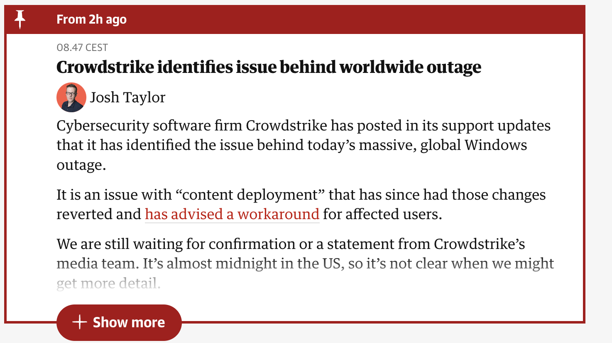

----

### What could have mitigated the impact?

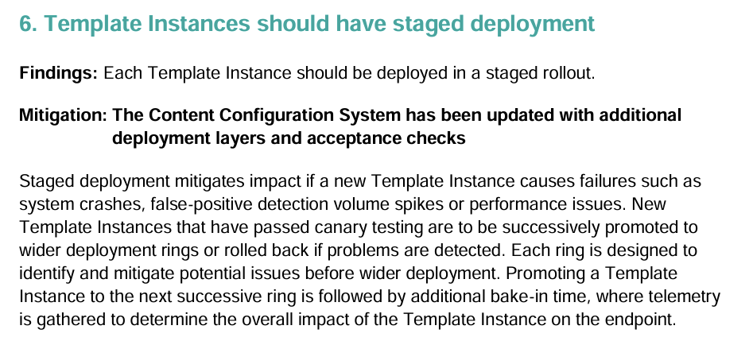

---

<!-- .slide: class="chapter-slide" data-background-color="#18262d" -->

# Progressive Delivery

----

> [Progressive Delivery](https://redmonk.com/jgovernor/2018/08/06/towards-progressive-delivery/) is a term that includes deployment strategies that try to avoid the pitfalls of all-or-nothing deployment strategies

----

> New versions being deployed do not replace existing versions but run in parallel for an amount of time receiving live production traffic, and are evaluated in terms of correctness and performance before the rollout is considered successful.

----

* Avoiding downtime
* Limit the blast radius
* Shorter time from idea to production

----

Rolling out changes to all users at once is risky

Canary rollouts and feature flags are safer

AI Agents can automate the loop fixing the failures


---


<!-- .slide: class="chapter-slide" data-background-color="#18262d" -->

# Progressive Delivery Techniques

----

## Rolling Updates

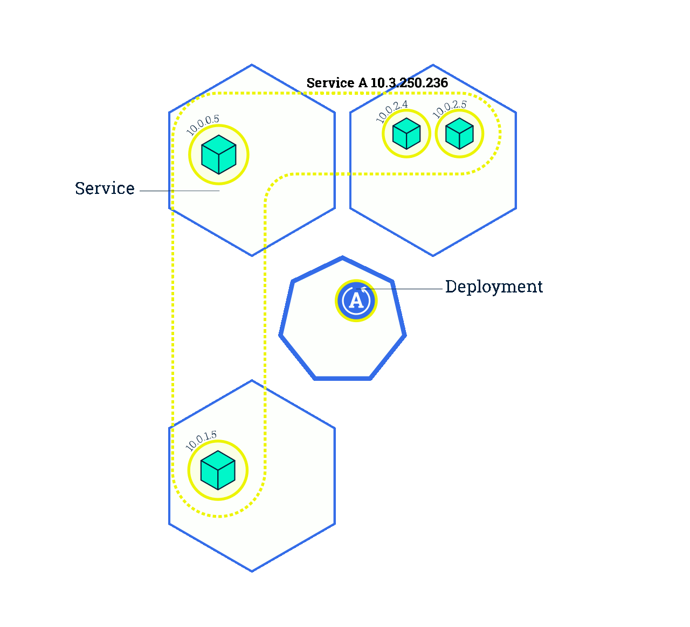

----

## Blue-Green Deployment

<a href="https://medium.com/continuous-deployment/continuous-deployment-strategies-32e2f7badd2">
  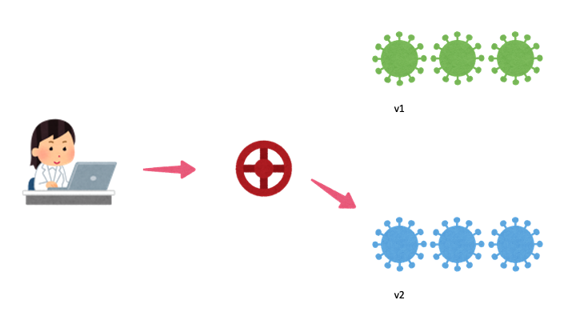
</a>

----

## Canary Deployment

<a href="https://medium.com/continuous-deployment/continuous-deployment-strategies-32e2f7badd2">
  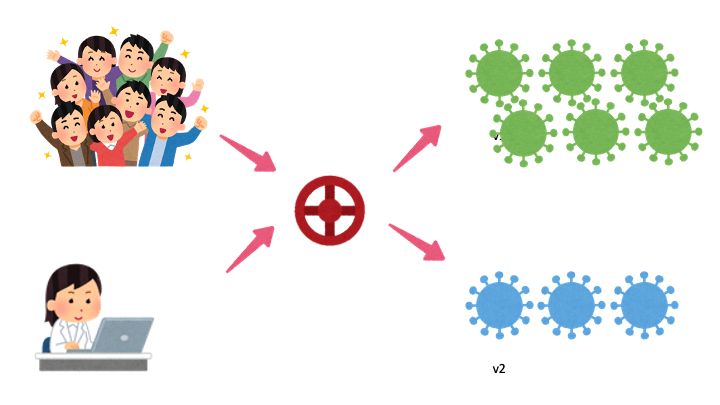
</a>

----

## Dark Launching

<a href="https://martinfowler.com/bliki/DarkLaunching.html">
  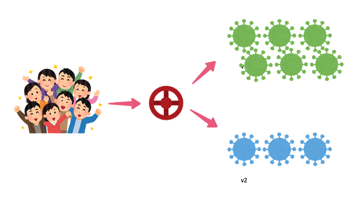
</a>

----

## Feature Flags

<a href="https://martinfowler.com/articles/feature-toggles.html">
  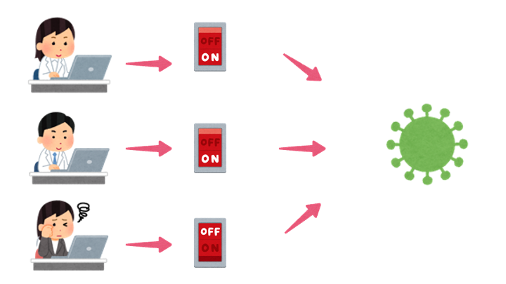
</a>


----

## Monitoring is the new testing

Know when users are experiencing issues **in production**

React to the issues **automatically**

----

> If you haven't automatically destroyed something by mistake, you are not automating enough


---


<!-- .slide: class="chapter-slide" data-background-color="#18262d" -->

# Progressive Delivery in Kubernetes

----

### Kubernetes Service Architecture

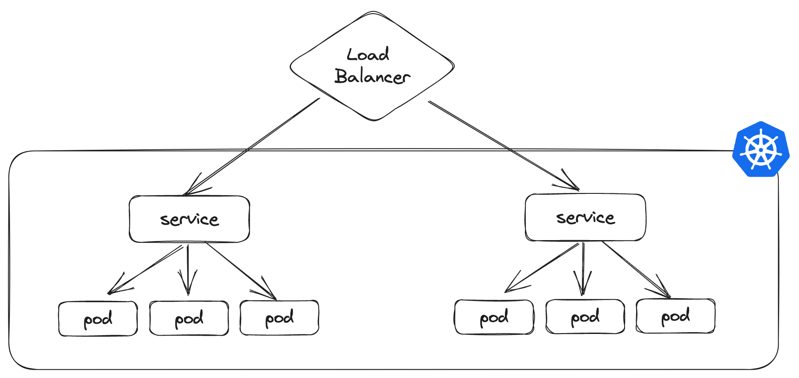

----

### Kubernetes Ingress Architecture

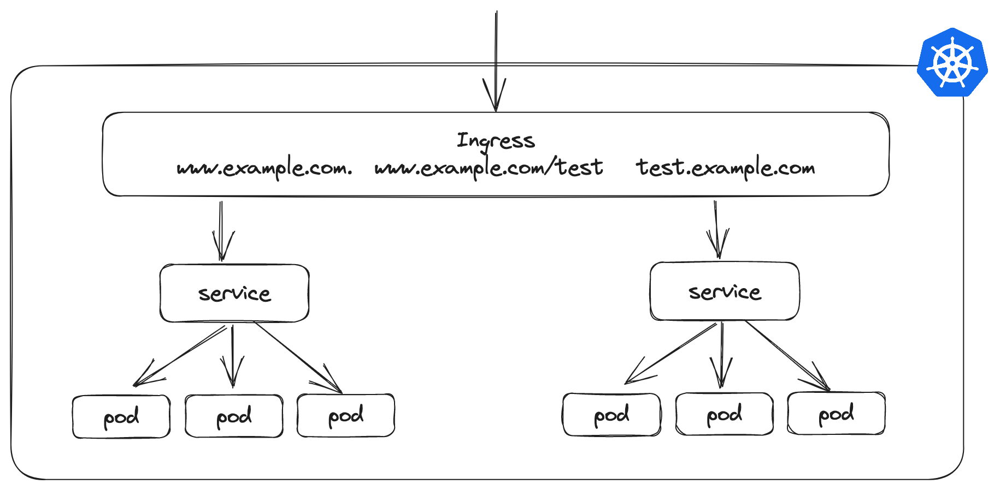


----

### Kubernetes Ingress

Ingress controllers:

* AWS
* GCE
* nginx
* Ambassador
* Istio Ingress
* Traefik
* HAProxy
* ...

---

<!-- .slide: class="chapter-slide" data-background-color="#18262d" -->

# GitOps

Git is the single source of truth

Treat everything as code

Operations through Git workflows

----

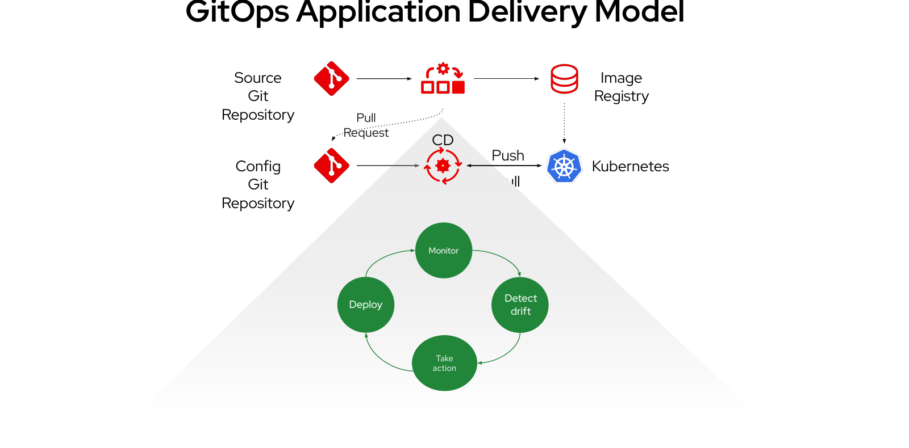

----

### By default:

A big bang / all or nothing release

---

<!-- .slide: class="chapter-slide" data-background-color="#18262d" -->

# Argo Rollouts

----

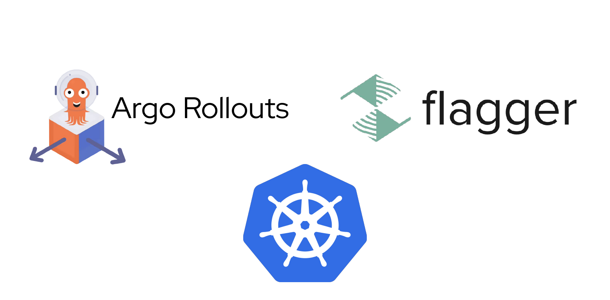

----

### Increase percentage of new (canary) version

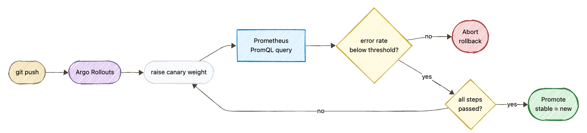

----

<!-- .slide: class="code-slide" -->

### Continuous analysis with Prometheus

```yaml
apiVersion: argoproj.io/v1alpha1
kind: AnalysisTemplate
metadata:
  name: success-rate
spec:
  args:
  - name: service-name
  metrics:
  - name: success-rate
    interval: 10s
    successCondition: len(result) == 0 || result[0] >= 0.95
    failureLimit: 2
    provider:
      prometheus:
        address: http://prometheus.istio-system.svc.cluster.local:9090
        query: |
          sum(irate(istio_requests_total{
            reporter="source",
            destination_service=~"{{args.service-name}}",
            response_code!~"5.*"}[30s])
          )
```

---

<!-- .slide: class="chapter-slide" data-background-color="#18262d" -->

# AI-Powered Rollout Analysis

----

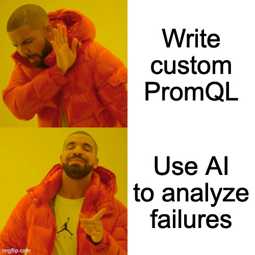

----

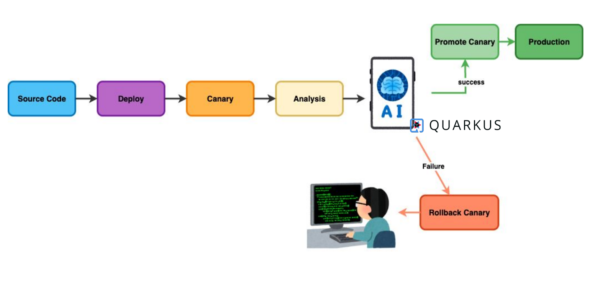

----

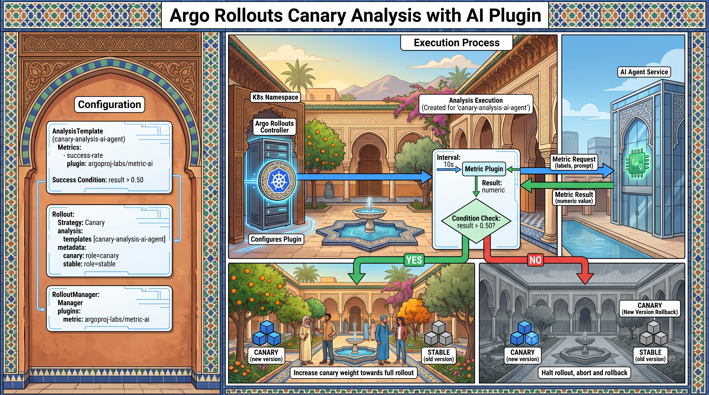

<!-- 

A detailed technical architectural infographic diagram titled "Argo Rollouts Canary Analysis with AI Plugin" (written at the top center), themed around Moroccan culture, architecture, and landscapes, illustrated in a clean, hand-drawn vector anime and comic style. All text and labels must be strictly in English. Use a wide 16:9 composition with large, crisp, legible technical labels suitable for projection.

Layout and Composition:
- Split into a narrow left configuration panel (about 30% of the width) and a broad right workflow panel, framed by carved Moroccan cedar wood and decorative zellij mosaic borders in cobalt blue, emerald green, ivory, and terracotta. Use precise Moroccan geometric tilework, not generic pan-African motifs. Keep decoration outside the technical cards and leave generous whitespace around labels.

Left Panel ("Configuration"):
- Styled like a warm terracotta tadelakt wall in a Moroccan riad, with a carved cedar lintel, a shallow horseshoe arch, and a subtle zellij tile base.
- Contains clean technical configuration cards:
  - Top Card: 
    "Configuration"
    "AnalysisTemplate (canary-analysis-ai-agent)"
    "Metrics:"
    "  - success-rate"
    "    plugin: argoproj-labs/metric-ai"
    "Success Condition: result > 0.50"
  - Middle Card:
    "Rollout:"
    "  Strategy: Canary"
    "  analysis:"
    "    templates [canary-analysis-ai-agent]"
    "  metadata:"
    "    canary: role=canary"
    "    stable: role=stable"
  - Bottom Card:
    "RolloutManager: Manager"
    "  plugins:"
    "    metric: argoproj-labs/metric-ai"

Right Workflow Panel ("Execution Process"):
- Header: "Execution Process" above a Moroccan riad courtyard, with warm ochre medina walls, an orange tree, and distant Atlas Mountain silhouettes.
- Central Hub: A riad courtyard with a small zellij fountain, horseshoe arches, carved plasterwork, and cedar lattice screens. Treat this as a contemporary Moroccan setting blending traditional craftsmanship with modern technology.
- Argo Rollouts Controller: Modern server rack integrated into a carved cedar alcove, branded with a glowing Kubernetes wheel emblem inside a zellij medallion, labeled "K8s Namespace", "Argo Rollouts Controller", and "Configures Plugin".
- Analysis Execution: An open courtyard arcade with Moroccan horseshoe arches labeled "Analysis Execution (Created for 'canary-analysis-ai-agent')", containing a clean white flowchart card: "Interval: 10s" -> "Metric Plugin" -> "Result: numeric" -> diamond decision box "Condition Check: result > 0.50?".
- AI Service Destination: On the far right, across a tiled fountain channel, a modern Casablanca-inspired glass building with geometric mashrabiya sunshades labeled "AI Agent Service" with a glowing green chip logo. Two clearly separated arrows connect the Metric Plugin and AI Agent Service: the outward arrow is labeled "Metric Request (labels, prompt)" and the returning arrow is labeled "Metric Result (numeric value)".

Outcome Paths at Bottom:
- YES Branch (Green arrow, bottom left): Leads to a bright Moroccan courtyard with orange and olive trees, zellij tiles, and a few small figures in a natural mix of djellabas and contemporary clothing. Displays blue cube clusters labeled "CANARY (new version)" and gray clusters labeled "STABLE (old version)", captioned: "Increase canary weight towards full rollout".
- NO Branch (Red arrow, bottom right): Shows the same Moroccan architectural setting under muted, overcast light to indicate a failed analysis, not a different culture or region. Labeled "CANARY (New Version Rollback)" with blue and gray cube clusters, captioned: "Halt rollout, abort and rollback".

Art Style & Aesthetic:
Clean vector line work, comic cel-shading, detailed technical schematic lines, warm terracotta and sand-colored tadelakt, cobalt-blue and emerald-green zellij accents, and ivory technical cards. Respectfully portray Moroccan design and everyday life without caricature. Prioritize accurate, readable English labels and unambiguous workflow arrows over decorative density. No Botswana motifs, thatched rondavels, cattle kraals, acacia savanna, or baobab scenery.

Generated with Nano Banana Pro (gemini-3-pro-image), 16:9, 2K.

 -->

----

<!-- .slide: class="code-slide" -->

### Register the AI metric plugin

```yaml
apiVersion: argoproj.io/v1alpha1
kind: RolloutManager
metadata:
  name: argo-rollouts
spec:
  plugins:
    metric:
    - name: argoproj-labs/metric-ai
      location: >-
        https://github.com/argoproj-labs/rollouts-plugin-metric-ai/releases/download/v0.0.1/rollouts-plugin-metric-ai-linux-amd64
```

----

<!-- .slide: class="code-slide" -->

### Configure canary analysis

```yaml
canary:
  analysis:
    startingStep: 1
    templates:
    - templateName: canary-analysis-ai-agent
  canaryMetadata:
    labels:
      role: canary
  stableMetadata:
    labels:
      role: stable
```

----

<!-- .slide: class="code-slide" -->

### Let the AI agent evaluate the rollout

```yaml
apiVersion: argoproj.io/v1alpha1
kind: AnalysisTemplate
metadata:
  name: canary-analysis-ai-agent
spec:
  metrics:
  - interval: 10s
    name: success-rate
    provider:
      plugin:
        argoproj-labs/metric-ai:
          agentUrl: http://kubernetes-agent:8080
          stableLabel: role=stable
          canaryLabel: role=canary
          extraPrompt: ignore aesthetic changes
    successCondition: result > 0.50
```

---


----

### Asynchronous remediation

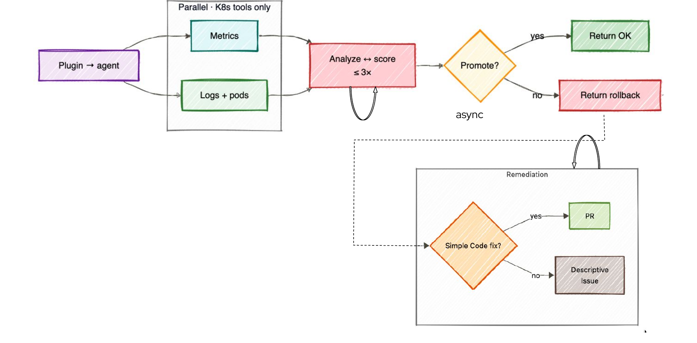

----

<!-- .slide: class="code-slide" -->

### Give the agent the source repository

```yaml
apiVersion: argoproj.io/v1alpha1
kind: AnalysisTemplate
metadata:
  name: canary-analysis-ai-agent
spec:
  metrics:
  - interval: 10s
    name: success-rate
    provider:
      plugin:
        argoproj-labs/metric-ai:
          agentUrl: http://kubernetes-agent:8080
          stableLabel: role=stable
          canaryLabel: role=canary
          extraPrompt: ignore aesthetic changes
          githubUrl: https://github.com/kdubois/argo-rollouts-quarkus-demo
```

---

<!-- .slide: class="chapter-slide" data-background-color="#18262d" -->

# Demo

----

<!-- .slide: data-background-video="demo-antigravity-quarkus.mp4" data-background-size="contain" data-background-color="#000000" -->

---

## Lessons learned

Performance was an interesting challenge

From one AI service to an agentic system: parallel and async agents

----

### LLM choice + context engineering + tool calling

Especially for PR creation

----

### Complexity vs portability

Could have used Serverless MCP, an external code assistant for PR creation, async remote agents, etc.

---

<!-- .slide: class="takeaways-slide" -->

## Takeaways

Rolling out changes to all users at once is risky

Canary rollouts and feature flags are safer

AI agents can automate the loop by analyzing metrics and logs, and even proposing fixes for failures

----


---

<!-- .slide: class="resources-slide" -->

## Resources

Argo Rollouts Plugin for AI metrics

[rollouts-plugin-metric-ai](https://github.com/argoproj-labs/rollouts-plugin-metric-ai)

Demo app

[argo-rollouts-quarkus-demo](https://github.com/kdubois/argo-rollouts-quarkus-demo)

Antigravity SDK Agents

[kubernetes-agents-antigravity](https://github.com/carlossg/kubernetes-agents-antigravity)

<!-- [kubernetes-aiops-agent](https://github.com/kdubois/kubernetes-aiops-agent) -->

<!-- [progressive-delivery](https://github.com/kdubois/progressive-delivery) -->

---

<!-- .slide: class="contact-slide" -->

<div class="container">

<div class="col">

[csanchez.org](http://csanchez.org)

[@csanchez](https://x.com/csanchez)<br>
[@csanchez.org](https://bsky.app/profile/csanchez.org)

 [carlossg](https://github.com/carlossg)

</div>

<div class="col">


</div>
</div>

<a href="http://adobe.com"></a>
