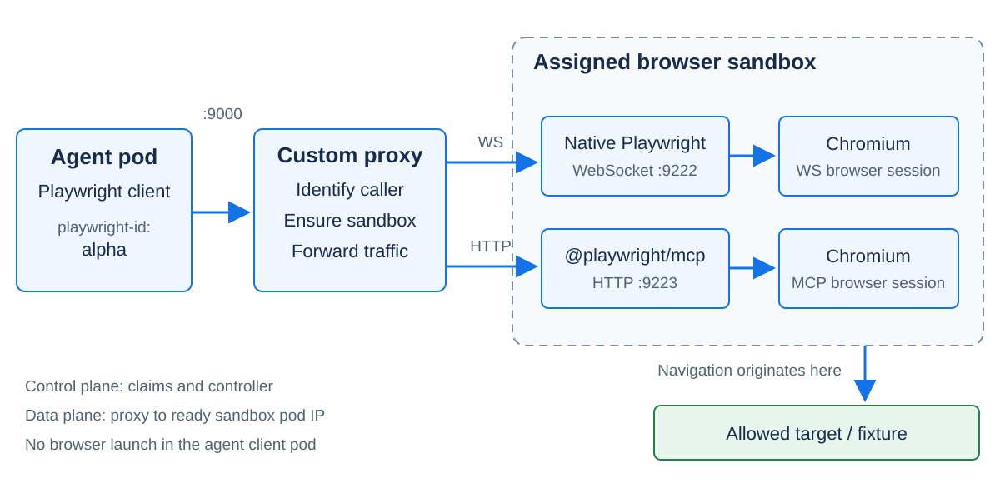
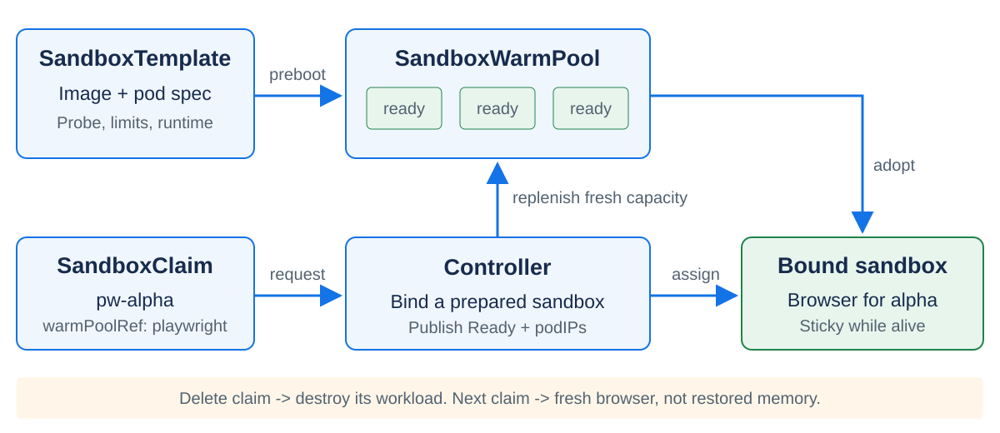

## Running Secure Agents at Scale

### Kubernetes sandboxes, with Playwright as the workload

<a href="https://adobe.com"></a>

Carlos Sanchez /
[csanchez.org](https://csanchez.org) /
[@csanchez.org](https://bsky.app/profile/csanchez.org)

<p class="compact">KubeCon + CloudNativeCon North America / November 11, 2026</p>

Note:
Suggested pacing: about 30 minutes, including 6-8 minutes for the demo, with questions afterward. This is a workload-driven comparison, not a claim that installing a sandbox controller makes an agent secure. The evidence snapshot is October 16, 2026. The appendix contains deployment and troubleshooting details.

----

## Carlos Sanchez

Principal Scientist

[Adobe Experience Manager](https://www.adobe.com/marketing/experience-manager)

Long-time OSS contributor:
Kubernetes, Jenkins, Apache Maven, ...

Note:
Introduce the platform-engineering motivation: make browser tools available to agents without placing every browser process, credential, and failure mode inside the agent's own container.

---

## Your agent needs a browser

### What else did you just give it?

Network access. Filesystem access. Credentials.

A long-lived process tree.

<p class="takeaway">A tool call is also a resource and trust-boundary decision.</p>

Note:
A page can be untrusted even when the agent's task is legitimate. This talk is about containing the execution environment and its network access; it does not claim to solve prompt injection or decide which actions an agent should be authorized to take.

---

## Why Playwright?

- Chromium is stateful and multiprocess
- Native WebSockets exercise the whole data plane
- Startup and reuse are measurable
- A real page fetch gives us a correctness check

<p class="takeaway">A green controller Deployment is not a working browser.</p>

Note:
The sandbox runs Node and Chromium; the labelled client pod runs the Playwright client. The browser must connect through the proxy, create a page, navigate, and return the expected target content. A successful WebSocket upgrade alone is insufficient.
Source: playwright-k8s-sandbox/docs/blog/playwright-k8s-sandbox-proxy.md.

---

## Three separate decisions

<div class="cards">
  <div class="card"><strong>Lifecycle</strong>Who creates, reuses, suspends, and deletes the environment?</div>
  <div class="card"><strong>Runtime</strong>What separates the workload from the host kernel and other workloads?</div>
  <div class="card"><strong>Policy</strong>Who may connect, and what may the browser reach?</div>
</div>

<p class="takeaway">Do not compare a warm pool with a kernel boundary.</p>

Note:
These are orthogonal axes. A namespace is useful for policy and resource organization, but is not a separate kernel. A warm pool changes provisioning latency, not the isolation mechanism. RuntimeClass selects a configured runtime; it does not install one.

---

<p class="eyebrow">01 / The options</p>

# Same workload.<br>Different contracts.

Note:
Start with the current, pinned integrations. Spend about six minutes on the landscape, then use agent-sandbox for the detailed walkthrough. Describe what this repository exercises, not every possible capability of each upstream project.

---

## Four current integrations

| Backend | Unit / provisioning | Runtime in this setup | State after lifecycle action |
|---|---|---|---|
| **agent-sandbox** | Claim a warm sandbox | Pod runtime; configurable | Recreate: fresh browser |
| **isola** | Sandbox CR; on demand | gVisor | Recreate: fresh browser |
| **substrate** | Actor on a worker | gVisor | Explicit memory suspend/resume |
| **Azure KARS** | CR; dedicated namespace | Pod + governed networking | Recreate: fresh browser |

<p class="source">Scope: the October 16, 2026 integration run. Versions and caveats are in the appendix. <a href="https://github.com/carlossg/playwright-k8s-sandbox/blob/5933817/docs/blog/sandbox-updates-2026-10.md">Source</a></p>

Note:
The agent-sandbox template does not set runtimeClassName, so the demo uses the cluster default, not a demonstrated gVisor or Kata configuration. KARS confidential/runtime extensions and Azure inference were not verified in this local run. Isola rootfs snapshot capabilities are not enabled by this adapter; do not generalize its delete/recreate behavior to every isola deployment.

---

## agent-sandbox

### Keep the browser warm. Claim it when needed.

- Kubernetes-native templates, warm pools, and claims
- Choose a configured pod runtime through `RuntimeClass`
- Reuse the sandbox while its claim is alive
- Pay for warm capacity before the request arrives

<p class="source"><a href="https://github.com/kubernetes-sigs/agent-sandbox">kubernetes-sigs/agent-sandbox</a> / tested integration: v1.0.7</p>

Note:
This is the main deep dive. The warm pool shifts startup work ahead of the request. A fresh claim can receive an already-running browser, but that is still a new logical session, not restoration of a previous tenant's memory. RuntimeClass support is a configuration option, not a performance result from this demo.

---

## isola

### An on-demand gVisor path

- A `Sandbox` CR creates a gVisor-isolated pod
- Shared sandbox namespace in this integration
- No warm pool in this adapter
- Fixture access needs an explicit network allowance

<p class="source"><a href="https://github.com/isola-run/isola">isola-run/isola</a> / tested integration: v0.7.0</p>

Note:
The upgrade installed checksum-verified runsc and its shim inside kind and configured containerd. Creating a gvisor RuntimeClass object alone had not been enough. The passing fixture fetch used a narrowly scoped cross-namespace policy and a namespace-qualified target name. The adapter uses the default Delete termination policy, not rootfs snapshots.

---

## substrate

### An actor lifecycle with memory resume

- API-managed actors run on gVisor workers
- Explicit suspend creates a durable memory snapshot
- A later request can trigger resume
- More control-plane and integration machinery

<p class="takeaway">Snapshot support matters only if the application resumes correctly.</p>

<p class="source"><a href="https://github.com/agent-substrate/substrate">agent-substrate/substrate</a> / tested integration: v0.5.0</p>

Note:
The October run observed SUSPENDED, a completed durable MEMORY-fidelity snapshot, and a successful browser navigation after resume. No forced boot was used. It did not run an in-memory marker oracle, so do not claim arbitrary cookies, tabs, JavaScript heap, or application state were proven to survive. This proxy's idle reaper deletes actors; it does not automatically hibernate them.

---

## Azure KARS

### A namespace per sandbox, with enforced egress

- Dedicated namespace and pod per `KarsSandbox`
- Namespace-scoped policy and resource boundaries
- Loopback browser rendering passed
- The private ClusterIP fixture fetch **failed**

<p class="takeaway warning">A domain allowlist did not override the tested private-IP restriction.</p>

<p class="source"><a href="https://github.com/Azure/kars">Azure/kars</a> / tested integration: v0.1.26</p>

Note:
The tested forward proxy rejects DNS answers resolving to private addresses. Adding another NetworkPolicy or domain allowlist did not override that check. Keep that limitation visible rather than disabling the guard to produce a green test. KARS inference, federation, signature verification, and confidential isolation were not tested. Namespace isolation is not a separate host-kernel boundary.

---

## And OpenShell?

The repository has a fifth backend.

In this harness, it uses the **SandboxClaim adapter**
with a different sandbox image.

It is in the original comparison, but **not in the
October pinned four-backend rerun**.

<p class="source"><a href="https://github.com/nvidia/openshell">nvidia/openshell</a> / <a href="https://github.com/carlossg/playwright-k8s-sandbox/blob/5933817/docs/blog/playwright-k8s-sandbox-proxy.md">Original comparison</a></p>

Note:
This is a statement about this repository's adapter, not a claim that every upstream OpenShell deployment has the same architecture or features as agent-sandbox. Do not reuse the older OpenShell measurements as current October results.

---

## Choose by constraint

| If you need... | Investigate... | Validate before committing |
|---|---|---|
| Fast assignment of prepared browsers | agent-sandbox | Warm capacity, runtime, and refill |
| On-demand pods with gVisor | isola | Runtime installation and network policy |
| Explicit memory suspend/resume | substrate | Application-state persistence oracle |
| Namespace-per-sandbox governance | KARS | Required targets under enforced egress |

<p class="takeaway">Choose the lifecycle and boundary your workload actually needs.</p>

Note:
These are evaluation paths, not universal product recommendations. The exact tool, network destinations, expected session state, and operational budget should drive selection. A namespace-per-tenant model may also be useful outside Azure; the tested integration did not prove Azure-specific capabilities.

---

<p class="eyebrow">02 / Inside agent-sandbox</p>

# Separate the agent<br>from the browser

Note:
About ten minutes for this section. Now follow one request through the actual repository implementation. The custom proxy is part of this application, not an upstream agent-sandbox component.

---

## One endpoint, dedicated sandboxes



<p class="source">Application architecture: <a href="https://github.com/carlossg/playwright-k8s-sandbox/blob/5933817/docs/ARCHITECTURE.md">playwright-k8s-sandbox</a>. This integration does not use upstream sandbox-router, sandboxd, or the SDKs.</p>

Note:
Point to the process boundary: the client controls a remote browser; it does not launch Chromium locally. The proxy identifies the client and provisions or reuses its sandbox. WS and MCP are separate listeners and browser-session paths, not two protocols connected to the same already-open browser. The fixture request originates in the sandbox.

---

## Four objects to understand

| Object | Responsibility |
|---|---|
| `SandboxTemplate` | Defines the workload pod |
| `SandboxWarmPool` | Keeps prepared sandboxes available |
| `SandboxClaim` | Requests a sandbox from the pool |
| `Sandbox` | Represents the managed workload |

<p class="takeaway">The controller manages lifecycle. The proxy carries browser traffic.</p>

Note:
The extension resources in this repo use extensions.agents.x-k8s.io/v1beta1. Do not imply the Kubernetes API server forwards browser WebSockets. After resolving a ready claim to its adopted pod IP, the proxy dials that pod directly.

---

## Define the browser workload

```yaml
apiVersion: extensions.agents.x-k8s.io/v1beta1
kind: SandboxTemplate
metadata:
  name: playwright
  namespace: pw-test
spec:
  networkPolicyManagement: Unmanaged
  podTemplate:
    spec:
      automountServiceAccountToken: false
      containers:
        - name: playwright
          image: localhost:5001/playwright-substrate:slim-1.53.0
          command: ["node", "/server.js"]
```

<p class="source">Excerpt: <a href="https://github.com/carlossg/playwright-k8s-sandbox/blob/5933817/test/playwright-sandboxtemplate.yaml">complete harness template</a>. Environment, probes, and limits omitted here. Image is preloaded into kind; replace it for a real registry.</p>

Note:
This is an excerpt, not the complete runnable manifest. The complete template configures NODE_PATH, the browser path, WS/MCP ports, Chromium flags, probes, and resource limits. Unmanaged disables the controller's network-policy management for this custom proxy; it is not an isolation guarantee. Explicit network policies and enforcement are production work, not something this field supplies.

---

## Preboot a small pool

```yaml
apiVersion: extensions.agents.x-k8s.io/v1beta1
kind: SandboxWarmPool
metadata:
  name: playwright
  namespace: pw-test
spec:
  replicas: 3
  sandboxTemplateRef:
    name: playwright
  updateStrategy:
    type: OnReplenish
```

<p class="takeaway">Three prepared sandboxes, not a three-tenant concurrency limit.</p>

Note:
The harness uses three prepared sandboxes for alpha, beta, and gamma. As sandboxes are claimed, the controller replenishes warm capacity, subject to node resources and scheduling. OnReplenish updates future replacements; do not promise that existing bound browsers are transparently updated.
Source: test/playwright-warmpool.yaml.

---

## Request one browser

```yaml
apiVersion: extensions.agents.x-k8s.io/v1beta1
kind: SandboxClaim
metadata:
  name: pw-alpha
  namespace: pw-test
  labels:
    playwright-id: alpha
    playwright-proxy/managed: "true"
spec:
  warmPoolRef:
    name: playwright
```

<p class="source">Claim shape from <a href="https://github.com/carlossg/playwright-k8s-sandbox/blob/5933817/internal/backend/sandboxclaim.go">the adapter</a>; additionalPodMetadata omitted. The proxy creates this resource.</p>

Note:
The adapter uses GET-first and creates only if absent. It also stamps a qualified additionalPodMetadata label for identifying the sandbox workload. A second request for the same ID should reuse the existing claim, not allocate another browser. The managed label allows scoped listing and cleanup.

---

## Claim, bind, replenish



<p class="takeaway">Prepared capacity is reusable infrastructure, not preserved tenant memory.</p>

Note:
Follow the lower request path, then point to prebooted capacity above it. Wait for Ready=True and a nonempty status.sandbox.podIPs before routing. Once assigned, the session is sticky while alive. On claim deletion the bound workload is destroyed, and fresh capacity replenishes the pool. Do not describe deletion as returning a tenant's live browser to another tenant.

---

## Ready means ready to use

The proxy waits for both:

```text
status.conditions[type=Ready].status == "True"
status.sandbox.podIPs contains an address
```

The browser template probes **9222**, after Chromium starts.

The server waits for the MCP listener before starting WS.

<p class="takeaway">Pod phase Running is not application readiness.</p>

Note:
The adapter polls every 500ms. In this dual-port server, MCP starts first and its TCP listener is checked before chromium.launchServer binds 9222. Therefore the WS readiness probe is the later startup signal. It does not prove an arbitrary page is reachable; the subsequent fetch test proves that.
Sources: internal/backend/sandboxclaim.go; test/playwright-substrate-server.js; test/playwright-sandboxtemplate.yaml.

---

## How does the caller get its browser?

```yaml
# On the client Job's pod template:
spec:
  template:
    metadata:
      labels:
        playwright-id: alpha
```

Source pod IP -> pod label -> session ID -> `pw-alpha`

Same ID: same live sandbox. Different IDs: different sandboxes.

<p class="takeaway warning">A user-controlled label is not tenant authentication.</p>

Note:
The proxy reads RemoteAddr and resolves the pod through an informer, with bounded API fallback. Unlabelled or unresolved callers are rejected. This assumes a trusted in-cluster network path that preserves source pod IPs. If tenants can choose another tenant's ID, the label scheme alone cannot isolate them: constrain ownership with admission, namespace/identity scoping, and authenticated ingress. Never expose it as an unauthenticated public browser endpoint.

---

## Two protocol paths

| Client API | Client endpoint | Sandbox listener |
|---|---|---|
| `chromium.connect()` | `ws://playwright-proxy:9000/` | Native Playwright WS: **9222** |
| MCP streamable HTTP | `http://playwright-proxy:9000/mcp` | `@playwright/mcp`: **9223** |

HTTP upgrade goes to WS.<br>
Plain HTTP goes to MCP.

<p class="source">Native Playwright protocol, not CDP. WS and MCP use separate browser sessions inside the sandbox.</p>

Note:
The public Service port stays the same. The proxy chooses the backend listener based on whether the request is a WebSocket upgrade. MCP's --isolated flag is a browser-context setting, not a substitute for a Kubernetes/runtime security boundary.
Sources: test/playwright-substrate-server.js and test/playwright-scripts.yaml.

---

## Playwright code stays familiar

```javascript
import { chromium } from 'playwright';

const browser = await chromium.connect(
  'ws://playwright-proxy:9000/'
);
try {
  const context = await browser.newContext();
  const page = await context.newPage();
  const response = await page.goto(
    'http://test-target.pw-test.svc.cluster.local/'
  );
  if (!response || !response.ok()) throw new Error('Fetch failed');
  if (!/Hostname:/.test(await page.content()))
    throw new Error('Expected fixture content is missing');
} finally {
  await browser.close();
}
```

<p class="source">Simplified client running in the labelled pod. The full harness adds bounded retries and timing. Match Playwright client/server versions.</p>

Note:
No chromium.launch here: the sandbox already owns the browser process. A positive response plus expected fixture content avoids treating an error page as success. The original fixture is whoami, but the component fetching it is real Chromium, not curl. The tests hold both client and browser at Playwright 1.53.0.

---

## Inside the sandbox

```javascript
import { chromium } from 'playwright';

const server = await chromium.launchServer({
  port: 9222,
  host: '0.0.0.0',
  wsPath: '/',
  args: process.env.CHROMIUM_ARGS.split(','),
});
console.log(server.wsEndpoint());
```

The image contains Node, Playwright, and Chromium.

<p class="source">Excerpt of the env-driven server. MCP is a separate process. <a href="https://github.com/carlossg/playwright-k8s-sandbox/blob/5933817/test/playwright-substrate-server.js">Full server</a></p>

Note:
The displayed excerpt assumes the template supplies CHROMIUM_ARGS, as the real template does; the actual server validates/configures its environment and handles startup failures. The sandbox, rather than the agent pod, launches Chromium. The current harness disables Chromium's own sandbox flags; the next slide makes that limitation explicit.

---

## Know the demo's security posture

- Agent-sandbox template uses the **cluster-default runtime**
- Chromium starts with **`--no-sandbox`**
- Template network-policy management is **Unmanaged**
- Browser pods do **not** mount service-account tokens

<p class="takeaway warning">This demonstrates the integration, not hardened hostile-code isolation.</p>

Note:
These are intentionally visible limits from the actual manifest. Do not present this demo as a production security recommendation. Stronger runtime isolation, policy enforcement, tenant authentication, and a validated browser security configuration are separate tasks. A RuntimeClass object alone does not provide gVisor/Kata without a configured node runtime. This is an architecture discussion, not a completed security audit.

---

## At scale, warm is not free

<div class="cards">
  <div class="card"><strong>Capacity</strong>3 warm pods request 750m CPU and 1.5 GiB memory before claims.</div>
  <div class="card"><strong>Refill</strong>Bursts consume ready capacity faster than new browsers may start.</div>
  <div class="card"><strong>Lifetime</strong>A live WebSocket prevents idle reap, even when it is silent.</div>
</div>

Bound sandboxes and client pods need capacity too.

Note:
The arithmetic is three times the template's 250m CPU and 512Mi memory requests, not a measurement of actual usage. Limits are 2 CPU and 2Gi per browser pod. Pool size is prepared reserve, not admission control. The proxy reaper requires both inactivity and zero active connections; use quotas, explicit lifetime/concurrency limits, and monitoring appropriate to your deployment.

---

<p class="eyebrow">03 / Demo</p>

# Playwright inside<br>agent-sandbox

### Two WS clients. One MCP client. Three sandboxes.

Note:
Allow 6-8 minutes with the local cluster and images prepared. The following slides are an executable walkthrough, not a claim that a new cluster run was performed when this deck was authored. The dated result slides are an offline fallback, not a recording of the current live run.

---

## Before going on stage

```bash
git clone https://github.com/carlossg/playwright-k8s-sandbox
cd playwright-k8s-sandbox
git checkout 5933817

bash test/harness.sh up
bash test/harness.sh e2e
```

- Requires Docker, kind, kubectl, Helm, and Go
- Match kubectl to the cluster; allow VM headroom
- Prebuild and preload the browser image

<p class="source">The harness creates local infrastructure and resets proxy-managed claims. Use a dedicated demo environment; do not run it on production.</p>

Note:
The pinned commit is the source snapshot for this deck. Run setup and an e2e rehearsal before the session: e2e builds the slim image, deploys the fixture, configures the pool/proxy, and runs the three clients. The 2026-10-16 result used kind 0.33.0, a 4-CPU/7.7-GiB Colima VM, and Kubernetes 1.35 for this backend. Its kubectl 1.37 mismatch is a known reproduction caveat; use a supported client version.

---

## Watch the claim, not just the pod

```bash
# Terminal 1: keep this watch running
kubectl --context kind-playwright-proxy -n pw-test \
  get sandboxclaims.extensions.agents.x-k8s.io -w
```

```bash
# Terminal 2: use the cached image and repeat the e2e
bash test/harness.sh e2e
```

Alpha and beta drive WS. Gamma drives MCP.

<p class="source">E2e intentionally clears old managed claims first; this is a fresh-assignment demo, not a warm-session timing measurement.</p>

Note:
Point out claim creation, readiness, and the controller replenishing prepared capacity. The harness may still take time to build/load images and wait for scheduling; do not promise the whole script completes in the subsecond connect time quoted for one client. A known-good rehearsal is essential.

---

## Prove separate sandboxes

```bash
kubectl --context kind-playwright-proxy -n pw-test \
  get sandboxclaims.extensions.agents.x-k8s.io \
  -o custom-columns=CLAIM:.metadata.name,SANDBOX:.status.sandbox.name

kubectl --context kind-playwright-proxy -n pw-test \
  logs job/playwright-e2e-alpha

kubectl --context kind-playwright-proxy -n pw-test \
  logs job/playwright-e2e-beta
```

Expect **different sandbox names** and successful fixture fetches.

<p class="takeaway">The target hostname can be the same: both browsers fetch the same fixture.</p>

Note:
This is a key demo distinction. The Hostname returned by whoami identifies the target pod, not the browser sandbox. Distinct status.sandbox.name values establish the separate assignments; response validation establishes that each real browser can fetch the fixture. The harness asserts both rather than inferring isolation from a different HTTP body.

---

## Show the MCP path too

```bash
kubectl --context kind-playwright-proxy -n pw-test \
  logs job/playwright-mcp-e2e-gamma
```

The client initializes MCP, lists tools, and calls
**`browser_navigate`** against the fixture.

Gamma must have a third, distinct sandbox.

<p class="source">Recorded October run: 25 tools advertised; navigation returned expected fixture content. This does not prove every advertised tool was exercised.</p>

Note:
Show gamma in the claim table beside alpha and beta. The pinned MCP 0.0.29 tool-list schema needs a documented compatibility workaround in the harness; navigation calls and expected response content are still checked. Do not claim a fully strict tools/list schema validation or an exhaustive MCP tool test.

---

## Reuse is not restore

```bash
bash test/bench.sh agent-sandbox
```

| Scenario | What happens |
|---|---|
| Cold | Create a new claim; use prepared capacity |
| Warm | Reuse the live sandbox |
| Script's `restore` | Delete and recreate; fresh browser |

<p class="takeaway">The same ID after deletion does not recover the old browser session.</p>

Note:
The script retains the name restore for compatibility. Narrate it as recreate for agent-sandbox, isola, and KARS. This benchmark changes lifecycle state, so run it only in the dedicated demo environment. A warm pool is not a snapshot store. Do not expect preserved tabs, cookies, or JavaScript memory after claim deletion.

---

<p class="eyebrow">04 / Evidence and limits</p>

# What actually worked?

Note:
Use this section if the live demo is unavailable. These are dated source-repository observations, not fabricated live terminal output. Show the successes and the failure with the same level of visibility.

---

## Test the browser, not the install

| Backend / path | October 16 recorded result |
|---|---|
| agent-sandbox: WS + MCP | **PASS**: separate assignments + real fixture fetch |
| isola: WS | **PASS**: gVisor pods + permitted cross-namespace fetch |
| substrate: WS | **PASS**: fetch + browser navigation after memory resume |
| KARS: loopback | **PASS**: WS-driven browser rendering |
| KARS: private fixture | **FAIL**: enforced egress boundary |

<p class="source"><a href="assets/benchmark-results.json">Local evidence record</a> / <a href="https://github.com/carlossg/playwright-k8s-sandbox/blob/5933817/test/results/2026-10-16-kind.json">Source record</a></p>

Note:
Do not combine the two KARS rows into a single green status. Browser rendering against 127.0.0.1 does not prove the browser can reach a private ClusterIP. The guard remained enabled. The fixture scenario failed in cold, warm, and recreate runs.

---

## Local lifecycle observations

### Client-observed total time, milliseconds

| Backend | Cold | Warm | Final scenario |
|---|---:|---:|---:|
| agent-sandbox | 633 | 465 | 579: recreate |
| isola | 3003 | 168 | 3455: recreate |
| substrate | 2448 | 281 | 930: memory resume |

<p class="takeaway warning">One observation per scenario. Not a performance ranking.</p>

<p class="source">Images preloaded; shared ARM64 VM; some runs overlapped; different cluster versions. KARS has no comparable successful fixture row. <a href="assets/benchmark-results.json">Full record</a></p>

Note:
Total includes connect, new page, and navigation. The final column intentionally labels different lifecycle operations. The older article used a larger 6-CPU/16-GiB environment, older versions, and a forced-boot substrate path; comparing those results as before/after speedups would be invalid. Warm-pool assignment is not a cold image pull or a brand-new cluster.

---

## Be precise about the missing proof

- Memory-fidelity resume is not an application-state oracle
- A loopback fetch is not private-network egress
- A warm pool is not an empty-node cold start
- One observation is not a latency distribution

<p class="takeaway">Report what the test establishes, not what the product name suggests.</p>

Note:
For substrate, add a JavaScript in-memory marker, a known open page, and assertions after suspension if those are real requirements. For performance, repeat runs with matched resources, runtime boundaries, cluster versions, and network paths, then report percentiles and errors. Keep guardrails enabled when evaluating compatibility.

---

## Before calling it production-ready

- Bind tenant identity to authenticated ownership
- Validate runtime and browser sandbox settings
- Enforce and test required ingress, DNS, and egress
- Bound concurrency, lifetime, CPU, memory, and storage
- Observe assignment, pool refill, errors, and cleanup

<p class="takeaway">Scale the policy and lifecycle model, not just the replica count.</p>

Note:
This is a deployment checklist, not a claim that this demo already implements all five controls. In particular, do not conflate the custom proxy's label routing with an authorization system, or its idle cleanup with a strict maximum session lifetime. A separate browser process prevents some shared-state accidents but does not by itself establish a hostile-code boundary.

---

## Three things to take away

### Compare lifecycle, runtime, and policy separately

### agent-sandbox makes prepared browsers easy to claim

### Prove the real browser path with enforcement enabled

Note:
Return to the opening question: what did the browser tool gain access to? Kubernetes gives us primitives to make the answer explicit, but a controller, runtime, and policy must be composed and tested. Agent-sandbox is a practical lifecycle building block, not the entire security architecture.

---

## Try the workload. Read the evidence.

[github.com/carlossg/playwright-k8s-sandbox](https://github.com/carlossg/playwright-k8s-sandbox)

[Original comparison](https://github.com/carlossg/playwright-k8s-sandbox/blob/5933817/docs/blog/playwright-k8s-sandbox-proxy.md)

[October update and caveats](https://github.com/carlossg/playwright-k8s-sandbox/blob/5933817/docs/blog/sandbox-updates-2026-10.md)

Carlos Sanchez / [csanchez.org](https://csanchez.org)

### Questions?

Note:
End of the main talk. The next slides are optional appendix material. Source snapshot: commit 5933817, feat: upgrade sandbox backends and document kind results. No new live-cluster test was performed during presentation authoring.

---

<p class="eyebrow">Appendix / Version scope</p>

## What was actually pinned?

| Component | Tested version |
|---|---|
| agent-sandbox | v1.0.7 |
| isola / chart | v0.7.0 / 0.7.0 |
| Azure KARS | v0.1.26 |
| substrate | v0.5.0 |
| Playwright / MCP / Node | 1.53.0 / 0.0.29 / 22 |

<p class="source">Checked October 16, 2026; not a claim about versions available on the conference date. <a href="https://github.com/carlossg/playwright-k8s-sandbox/blob/5933817/test/versions.env">Version pins</a></p>

Note:
The update compares this repository's previous integrations against these pins, not each project's immediately preceding upstream release. Previous KARS/substrate source checkouts and the old isola chart were not reliably recorded as deployed release pins.

---

<p class="eyebrow">Appendix / Runtime choice</p>

## Same lifecycle, different boundary

```yaml
# SandboxTemplate excerpt; requires configured nodes:
spec:
  podTemplate:
    spec:
      runtimeClassName: gvisor
```

Standard containers share the host kernel.<br>
gVisor interposes a userspace kernel.<br>
Kata uses a VM-based boundary.

<p class="takeaway warning">Selecting a RuntimeClass is not installing or validating its runtime.</p>

Note:
This is a configuration illustration, not the measured agent-sandbox setup. Install the corresponding runtime and shim on nodes, configure containerd, and validate Chromium under the chosen runtime. Do not reuse the cluster-default benchmark timings for gVisor or Kata. The isola harness includes test/install-gvisor-kind.sh for its local gVisor installation.

---

<p class="eyebrow">Appendix / Troubleshooting</p>

## Follow the failed boundary

| Symptom | Inspect |
|---|---|
| Caller rejected | Pod label ownership, preserved source IP, informer readiness |
| Claim never ready | Controller conditions, template, scheduling, pool capacity |
| WS connects; page fails | Browser logs, DNS, target readiness, enforced egress |
| MCP fails; WS works | MCP process, 9223 routing, protocol/version compatibility |
| Idle resource never reaped | Active WebSocket count, TTL, client cleanup |

<p class="takeaway">Fix the narrow integration contract; do not disable the boundary to hide the failure.</p>

Note:
The management port is 9090; health/readiness probes should not accidentally provision a browser. The data-plane Service is on 9000. Reading the claim's actual Ready condition is more useful than checking only a Deployment or pod phase.

---

<p class="eyebrow">Appendix / Reproduce other backends</p>

## Same browser, different backend

```bash
bash test/harness.sh up-isola
bash test/harness.sh test isola

bash test/harness.sh up-substrate
SUBSTRATE_FLAVOUR=playwright bash test/harness.sh test substrate

bash test/harness.sh up-kars
bash test/harness.sh test kars
# The original private fixture currently fails under enforced egress.
```

<p class="source">Run from the pinned source checkout. Substrate has additional prerequisites and its own cluster; follow <a href="https://github.com/carlossg/playwright-k8s-sandbox/blob/5933817/deploy/examples/substrate/README.md">the deployment guide</a>.</p>

Note:
Do not spin up every sample simultaneously in a small VM. The recorded substrate run used SUBSTRATE_NS=pw-substrate-v050 and SUBSTRATE_TEMPLATE_NAME=playwright-multiprocess; use fresh names when immutable template contents change. For timing, restart the proxy before suspension, not after, so startup reconciliation cannot pre-resume the actor outside the measured request.
