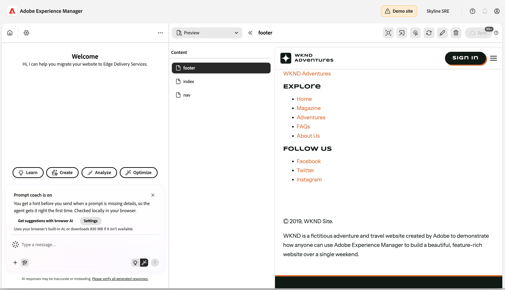
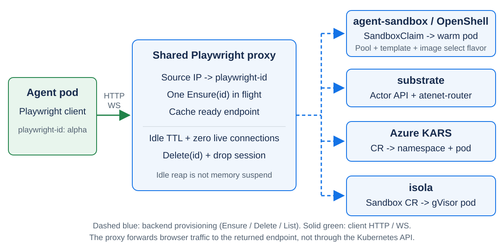
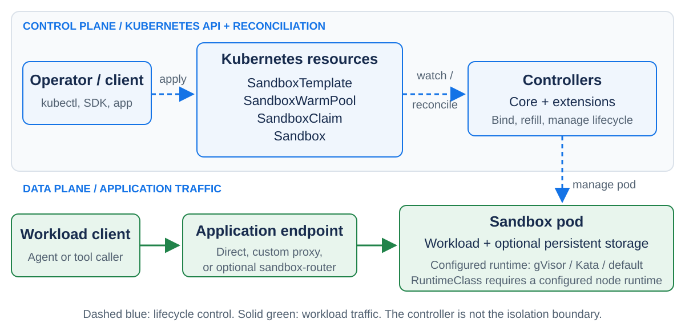
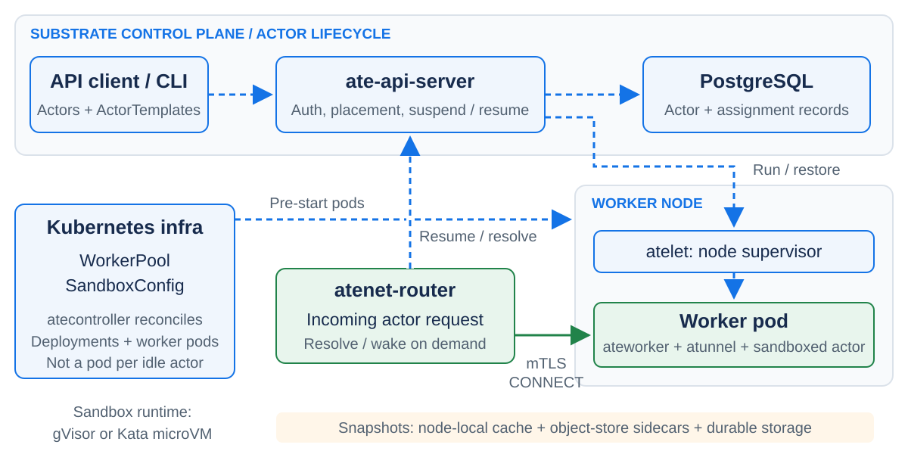
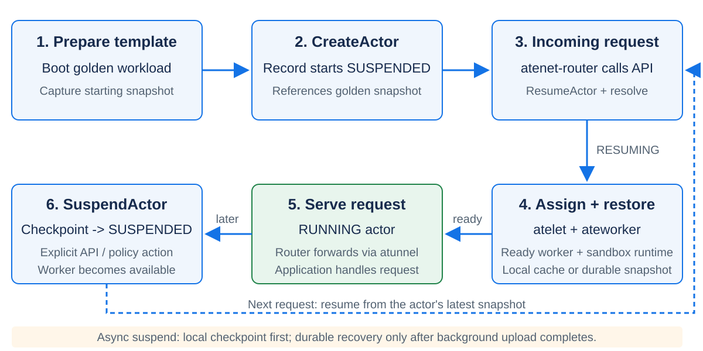
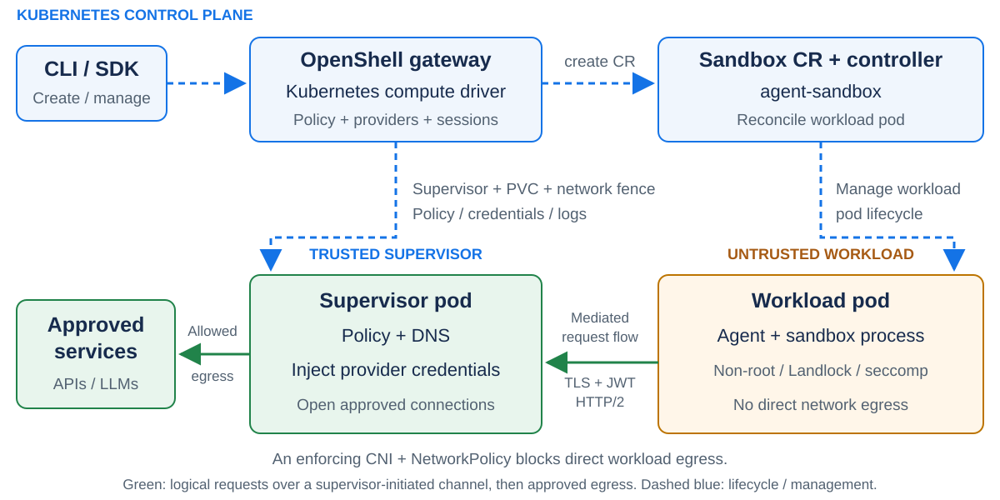
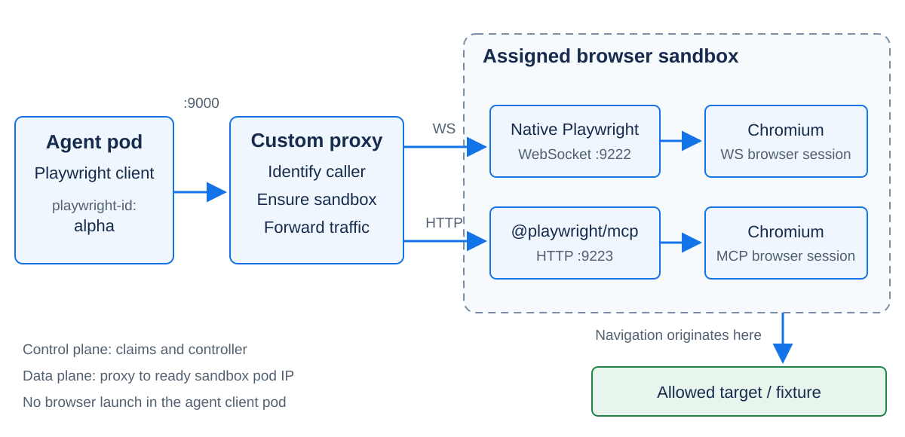
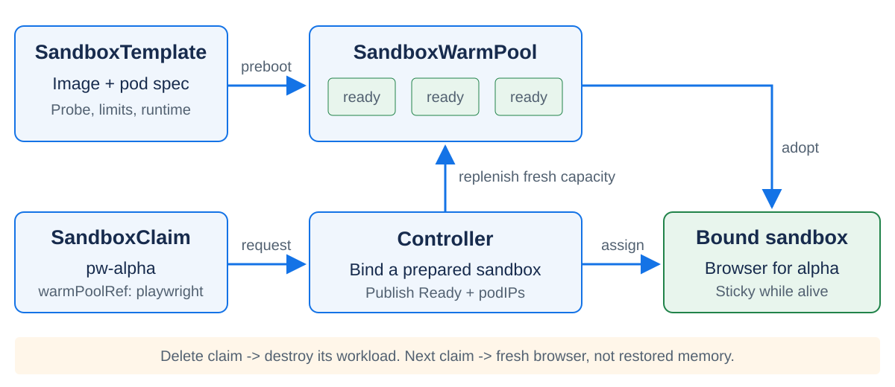

<!-- .slide: class="title-slide" -->

## Running Secure Agents at Scale

<a href="https://adobe.com"></a>

Carlos Sanchez /
[csanchez.org](https://csanchez.org) /
[@csanchez](https://twitter.com/csanchez)

Note:
Suggested pacing: about 30 minutes, including a live demo if available, with questions afterward. This is a workload-driven comparison, not a claim that installing a sandbox controller makes an agent secure. The evidence snapshot is October 16, 2026; sources and version caveats are in the speaker notes and assets/benchmark-results.json.

----

<!-- .slide: class="bio-slide" -->

## Carlos Sanchez

Principal Scientist

[Adobe Experience Manager](https://www.adobe.com/marketing/experience-manager)

Long-time OSS contributor:
Kubernetes, Jenkins, Apache Maven,...

Note:
Introduce the platform-engineering motivation: make browser tools available to agents without placing every browser process, credential, and failure mode inside the agent's own container.

---

<!-- .slide: class="chapter-slide" data-background-color="#18262d" -->

<p class="eyebrow">The use case</p>

## Let's run 1000s of agents

Importing sites into the platform

Changing and improving design

----



----

## Implementation

One user, one pod

Persistent storage per user

No credentials in the agent

Playwright for browser automation

----

## Issues

Isolation

Multiple pods mounting one persistent volume during rollouts

Image size

Resource consumption


----

## Agent needs a browser

### What else did you just give it?

Network access. Filesystem access. Credentials.


Note:
A page can be untrusted even when the agent's task is legitimate. OpenClaw is an illustrative agent application, not a sixth sandbox backend or a tested client integration in this harness. This talk is about containing the execution environment and its network access; it does not claim to solve prompt injection or decide which actions an agent should be authorized to take.

----

## Why Playwright?

- Chromium is stateful and multiprocess
- Native WebSockets exercise the whole data plane
- Startup and reuse are measurable
- A real page fetch gives us a correctness check

<p class="takeaway"><a href="https://github.com/ai-ecoverse/playwright-k8s-sandbox">https://github.com/ai-ecoverse/playwright-k8s-sandbox</a></p>


Note:
The sandbox runs Node and Chromium; the labelled client pod runs the Playwright client. The browser must connect through the proxy, create a page, navigate, and return the expected target content. A successful WebSocket upgrade alone is insufficient.
Source: playwright-k8s-sandbox/docs/blog/playwright-k8s-sandbox-proxy.md.

----

## Three separate decisions

<div class="cards">
  <div class="card"><strong>Lifecycle</strong>Who creates, reuses, suspends, and deletes the environment?</div>
  <div class="card"><strong>Runtime</strong>What separates the workload from the host kernel and other workloads?</div>
  <div class="card"><strong>Policy</strong>Who may connect, and what may the browser reach?</div>
</div>


Note:
These are orthogonal axes. A namespace is useful for policy and resource organization, but is not a separate kernel. A warm pool changes provisioning latency, not the isolation mechanism. RuntimeClass selects a configured runtime; it does not install one.

---

<!-- .slide: class="chapter-slide" data-background-color="#18262d" -->

<p class="eyebrow">The options</p>

# Same workload.<br>Different contracts.

Note:
Start with the five supported integrations, distinguishing the four pinned October runs from the OpenShell adapter description. Spend about six minutes on the landscape, then use agent-sandbox for the detailed walkthrough. Describe what this repository exercises, not every possible capability of each upstream project.

----

## Five implementations

| Backend | Unit / provisioning | Runtimes supported | State after lifecycle action |
|---|---|---|---|
| **agent-sandbox** | Claim a warm sandbox | gVisor / Kata / default | Recreate: fresh browser |
| **OpenShell** | Claim from OpenShell pool | Docker / Podman / K8s / microVM | Recreate: fresh browser |
| **substrate** | Actor on a worker | gVisor / Kata + Cloud Hypervisor | Explicit memory suspend/resume |
| **Azure KARS** | CR; dedicated namespace | runc / Kata + AMD SEV-SNP | Recreate: fresh browser |
| **isola** | Sandbox CR; on demand | gVisor | Recreate: fresh browser |


Note:
The runtime column describes upstream support, not just the October tested configuration. The provisioning and lifecycle columns still describe this harness's integration paths. Agent-sandbox delegates isolation through RuntimeClass to a runtime already configured on the nodes; default means the cluster's default pod runtime. OpenShell names compute drivers here: Docker, Podman, Kubernetes, and microVM; its Kubernetes driver also permits an operator-enabled Kata RuntimeClass override. Native Windows MXC is documented separately on the Windows branch and is outside this Linux/Kubernetes comparison. Substrate's microvm class uses Kata plus Cloud Hypervisor and requires KVM-capable Linux nodes. KARS uses standard runc for standard/enhanced isolation; confidential isolation opts into Kata plus AMD SEV-SNP and requires an appropriately configured confidential-computing node pool. Its agent-framework selector, spec.runtime.kind (OpenClaw, LangGraph, and others), is a different meaning of runtime and is not the isolation runtime listed here. Isola requires gVisor.

The agent-sandbox template does not set runtimeClassName, so the demo uses the cluster default, not a demonstrated gVisor or Kata configuration. KARS confidential/runtime extensions and Azure inference were not verified in this local run. OpenShell shares the claim adapter but uses its own pool, template, and image; its lifecycle description is not an October observation or a claim about all upstream OpenShell deployments. Isola rootfs snapshot capabilities are not enabled by this adapter; do not generalize its delete/recreate behavior to every isola deployment.

Runtime references, not harness upgrades or new benchmark runs: [agent-sandbox v1.0.10](https://github.com/kubernetes-sigs/agent-sandbox/blob/v1.0.10/README.md), [OpenShell v0.1.8](https://github.com/NVIDIA/OpenShell/blob/v0.1.8/docs/how-it-works/sandboxes/runtimes.mdx), [Substrate v1.0.0](https://github.com/agent-substrate/substrate/blob/v1.0.0/docs/reference/sandbox-classes.md), [KARS v0.1.26](https://github.com/Azure/kars/blob/v0.1.26/docs/security.md#layer-2--pod-isolation-optional-vm), [isola v0.8.1](https://github.com/isola-run/isola/blob/v0.8.1/README.md).

----

## One proxy, five backend choices




Note:
This is the source document's component overview and session-manager sequence redrawn for the presentation, not an upstream OpenShell architecture diagram. Five backend names map to four adapter paths because agent-sandbox and OpenShell share SandboxClaim. Identity resolution and singleflight Ensure avoid provisioning a separate sandbox for each concurrent request with the same ID. The endpoint remains sticky while the session is alive. Idle cleanup requires both elapsed inactivity and zero active connections, then calls Delete, including for Substrate; it is not automatic suspend. Blue paths describe lifecycle operations, not WebSocket forwarding through CRDs. Real browser traffic uses the resolved endpoint, with atenet-router as Substrate's data plane. The label is an application routing convention, not tenant authentication. The source repository moved from carlossg to ai-ecoverse; the earlier pinned evidence links still refer to the same repository.

Source: [playwright-k8s-sandbox architecture](https://github.com/ai-ecoverse/playwright-k8s-sandbox/blob/ebd239800163bf8e86c4e9d77f857ab21b4b7898/docs/ARCHITECTURE.md).

----

## agent-sandbox

### Keep the browser warm. Claim it when needed.

- Kubernetes-native templates, warm pools, and claims
- Choose a configured pod runtime through `RuntimeClass`
- Reuse the sandbox while its claim is alive
- Pay for warm capacity before the request arrives


Note:
This is the main deep dive. The warm pool shifts startup work ahead of the request. A fresh claim can receive an already-running browser, but that is still a new logical session, not restoration of a previous tenant's memory. RuntimeClass support is a configuration option, not a performance result from this demo.

----

## agent-sandbox: controllers, not a new kernel



<p class="source">Upstream architecture: <a href="https://github.com/kubernetes-sigs/agent-sandbox/blob/v1.0.7/README.md#architecture">agent-sandbox v1.0.7</a>. This demo uses its own proxy, not the optional upstream sandbox-router.</p>

Note:
The control plane is the Kubernetes API plus the core and extension controllers. SandboxTemplate supplies the pod blueprint; SandboxWarmPool maintains prepared capacity; SandboxClaim requests and adopts a sandbox; Sandbox manages the workload pod. A user can also create a Sandbox directly without using the warm-pool extensions. Controllers create and reconcile Kubernetes resources; browser requests use a separate data path. The endpoint box lists deployment options, not three proxies in series. In this deck it is the custom Playwright proxy. The sandbox-router is optional and is not installed by this integration. Persistent storage is optional and does not imply a saved browser heap. RuntimeClass selects an already-configured runtime; this demo leaves it unset and therefore uses the cluster default. The application diagram and claim lifecycle in the later agent-sandbox deep dive show how those building blocks are used here.

----

## substrate

### An actor lifecycle with memory resume

- Actors run on gVisor or Kata microVM workers
- Memory snapshots become durable after upload completes
- A later request can trigger resume
- More control-plane and integration machinery

<p class="takeaway">Snapshot support matters only if the application resumes correctly.</p>


Note:
The October run observed SUSPENDED, a completed durable MEMORY-fidelity snapshot, and a successful browser navigation after resume. No forced boot was used. It did not run an in-memory marker oracle, so do not claim arbitrary cookies, tabs, JavaScript heap, or application state were proven to survive. This proxy's idle reaper deletes actors; it does not automatically hibernate them.

----

## Substrate: two control-plane layers




Note:
Separate the two reconciliation rates. Kubernetes and atecontroller provision infrastructure from WorkerPool and SandboxConfig CRDs. Actors and ActorTemplates are Substrate API records, not a Kubernetes object and pod for every idle actor. The API stores placement in PostgreSQL and tells the node's atelet to run or restore a workload via ateworker. The router resolves the target actor and forwards traffic over an authenticated atunnel path; it does not send application traffic through the Kubernetes API. Each worker uses the configured sandbox class: gVisor or Kata with Cloud Hypervisor. Snapshot transfers use object-store sidecars and a node-local cache. Outbound traffic takes a separate policy-enforcing atenet-egress path, omitted to keep the ingress diagram readable. This diagram documents upstream v1.0.0, not a new integration test or an upgrade of the v0.5.0 evidence.

Source: [Substrate v1.0.0 architecture](https://github.com/agent-substrate/substrate/blob/v1.0.0/docs/concepts/architecture.md).

----

## Substrate: wake, serve, checkpoint




Note:
Follow the top row left to right, then the lower row right to left. The template's golden snapshot starts new actor instances; subsequent resumes use that actor's latest snapshot. ResumeActor can restore from node-local state or a completed durable snapshot, with runtime compatibility and fidelity affecting the restoration path. An incoming request can trigger resume, but the end of a request does not automatically suspend the actor: suspension is an explicit API call or an action taken by a higher-level policy. The default asynchronous suspend returns after the local checkpoint; a node failure before upload completes can lose that latest state. The October harness explicitly waited for a completed durable MEMORY snapshot, but did not prove arbitrary application-state persistence. Its custom proxy's idle cleanup deletes actors, rather than calling SuspendActor.

----

## Azure KARS

### A namespace per sandbox, with enforced egress

- Dedicated namespace and pod per `KarsSandbox`
- Namespace-scoped policy and resource boundaries
- Oriented towards personal agents like OpenClaw

Note:
The tested forward proxy rejects DNS answers resolving to private addresses. Adding another NetworkPolicy or domain allowlist did not override that check. Keep that limitation visible rather than disabling the guard to produce a green test. KARS inference, federation, signature verification, and confidential isolation were not tested. Namespace isolation is not a separate host-kernel boundary.

----

## OpenShell in this harness

- Uses the same **SandboxClaim adapter and controller**
- Selects `WARMPOOL_NAME=playwright-openshell`
- That pool references its own template and sandbox image
- Reuse while alive; deleting the claim means a fresh browser

Note:
This describes the OpenShell backend in this repository's harness, not every upstream OpenShell deployment. Its claim selects the playwright-openshell pool, rather than the default playwright pool; the pool and template select the workload image. The source document also describes deploying two proxies against separate pools in the same cluster. Deletion destroys the claimed workload and does not restore the browser's previous memory. Do not generalize the shared adapter to OpenShell's complete runtime or security model, or reuse historical OpenShell measurements as October results. The next diagram describes upstream v0.1.8, not components installed or verified by this historical image adapter.

----

## OpenShell: gateway, supervisor, workload



Note:
Separate upstream OpenShell from the earlier harness adapter. In the v0.1.8 Kubernetes runtime, the gateway's compute driver creates the Sandbox CR, a separate supervisor pod, the boundary Service, NetworkPolicy, and workspace PVC; the agent-sandbox controller creates the workload pod. The driver also provisions the protected channel and initial credentials. The gateway manages lifecycle, policy, providers, and sessions; its policy prover is omitted from this simplified diagram. The supervisor confirms the boundary before launching the agent and maintains an outbound session to the gateway. The current Linux workload uses non-root execution, Landlock filesystem restrictions, and seccomp-mediated network operations. Provider credentials remain on the trusted side and are injected only where policy permits. Green arrows show logical agent TCP/DNS request flow, not new workload-initiated TCP connections: the supervisor initiates the TLS/HTTP2 boundary connection and authenticates with a sandbox JWT; agent requests return over that established channel. The workload cannot initiate direct outbound connections. Kubernetes must use a CNI enforcing ingress and egress NetworkPolicy; merely creating policy objects is insufficient. The supervisor, not the agent-sandbox controller, evaluates requests and opens allowed upstream connections. Separate pods are not a separate-kernel guarantee. Other OpenShell compute runtimes use different boundary transports; the drawing is specifically the Kubernetes path. None of these upstream v0.1.8 security properties were established by the October four-backend rerun, which excluded OpenShell.

Sources: [OpenShell v0.1.8 architecture](https://github.com/NVIDIA/OpenShell/blob/v0.1.8/docs/about/architecture.mdx) and [Kubernetes setup](https://github.com/NVIDIA/OpenShell/blob/v0.1.8/docs/kubernetes/setup.mdx).

<!--
## isola

### An on-demand gVisor path

- A `Sandbox` CR creates a gVisor-isolated pod
- Shared sandbox namespace in this integration
- No warm pool in this adapter
- Fixture access needs an explicit network allowance


Speaker notes for hidden slide:
The upgrade installed checksum-verified runsc and its shim inside kind and configured containerd. Creating a gvisor RuntimeClass object alone had not been enough. The passing fixture fetch used a narrowly scoped cross-namespace policy and a namespace-qualified target name. The adapter uses the default Delete termination policy, not rootfs snapshots. -->

----

## Choose by constraint

| If you need... | Investigate... | Validate before committing |
|---|---|---|
| Fast assignment of prepared browsers | agent-sandbox | Warm capacity, runtime, and refill |
| OpenShell-specific browser pool/image | OpenShell | Image, runtime, policy; rerun the workload |
| Explicit memory suspend/resume | substrate | Application-state persistence oracle |
| Running OpenClaw-style agents | KARS | Required targets under enforced egress |

<p class="takeaway">Choose the lifecycle and boundary your workload actually needs.</p>

Note:
These are evaluation paths, not universal product recommendations. The exact tool, network destinations, expected session state, and operational budget should drive selection. A namespace-per-tenant model may also be useful outside Azure; the tested integration did not prove Azure-specific capabilities. OpenShell is an available adapter path, not a measured October recommendation; validate its chosen image and runtime before adopting it.

---

<!-- .slide: class="chapter-slide" data-background-color="#18262d" -->

<p class="eyebrow">Inside agent-sandbox</p>

# Separate the agent<br>from the browser

Note:
About ten minutes for this section. Now follow one request through the actual repository implementation. The custom proxy is part of this application, not an upstream agent-sandbox component.

----

## One endpoint, dedicated sandboxes




Note:
Point to the process boundary: the client controls a remote browser; it does not launch Chromium locally. The proxy identifies the client and provisions or reuses its sandbox. WS and MCP are separate listeners and browser-session paths, not two protocols connected to the same already-open browser. The fixture request originates in the sandbox. The client/proxy and warm-pool drawings are presentation-specific adaptations of the source architecture and lifecycle descriptions, not verbatim Mermaid renders. Use the pinned v1.0.7 readiness fields shown here, rather than the older phase=Bound examples retained in the source document. Its pre-v0.5 Substrate sequence and Boot=true workaround are explicitly historical and are not the current demo contract.

----

## Four objects to understand

| Object | Responsibility |
|---|---|
| `SandboxTemplate` | Defines the workload pod |
| `SandboxWarmPool` | Keeps prepared sandboxes available |
| `SandboxClaim` | Requests a sandbox from the pool |
| `Sandbox` | Represents the managed workload |

<p class="takeaway">The controller manages lifecycle. The proxy carries browser traffic.</p>

Note:
The extension resources in this repo use extensions.agents.x-k8s.io/v1beta1. Do not imply the Kubernetes API server forwards browser WebSockets. After resolving a ready claim to its adopted pod IP, the proxy dials that pod directly.

----

## Define the browser workload

```yaml
apiVersion: extensions.agents.x-k8s.io/v1beta1
kind: SandboxTemplate
metadata:
  name: playwright
  namespace: pw-test
spec:
  networkPolicyManagement: Unmanaged
  podTemplate:
    spec:
      automountServiceAccountToken: false
      containers:
        - name: playwright
          image: localhost:5001/playwright-substrate:slim-1.53.0
          command: ["node", "/server.js"]
```


Note:
This is an excerpt, not the complete runnable manifest. The complete template configures NODE_PATH, the browser path, WS/MCP ports, Chromium flags, probes, and resource limits. Unmanaged disables the controller's network-policy management for this custom proxy; it is not an isolation guarantee. Explicit network policies and enforcement are production work, not something this field supplies.

----

## Preboot a small pool

```yaml
apiVersion: extensions.agents.x-k8s.io/v1beta1
kind: SandboxWarmPool
metadata:
  name: playwright
  namespace: pw-test
spec:
  replicas: 3
  sandboxTemplateRef:
    name: playwright
  updateStrategy:
    type: OnReplenish
```

<p class="takeaway">Three prepared sandboxes, not a three-tenant concurrency limit.</p>

Note:
The harness uses three prepared sandboxes for alpha, beta, and gamma. As sandboxes are claimed, the controller replenishes warm capacity, subject to node resources and scheduling. OnReplenish updates future replacements; do not promise that existing bound browsers are transparently updated.
Source: test/playwright-warmpool.yaml.

----

## Request one browser

```yaml
apiVersion: extensions.agents.x-k8s.io/v1beta1
kind: SandboxClaim
metadata:
  name: pw-alpha
  namespace: pw-test
  labels:
    playwright-id: alpha
    playwright-proxy/managed: "true"
spec:
  warmPoolRef:
    name: playwright
```

<p class="source">Claim shape from <a href="https://github.com/carlossg/playwright-k8s-sandbox/blob/5933817/internal/backend/sandboxclaim.go">the adapter</a>; additionalPodMetadata omitted. The proxy creates this resource.</p>

Note:
The adapter uses GET-first and creates only if absent. It also stamps a qualified additionalPodMetadata label for identifying the sandbox workload. A second request for the same ID should reuse the existing claim, not allocate another browser. The managed label allows scoped listing and cleanup.

----

## Claim, bind, replenish



<p class="takeaway">Prepared capacity is reusable infrastructure, not preserved tenant memory.</p>

Note:
Follow the lower request path, then point to prebooted capacity above it. Wait for Ready=True and a nonempty status.sandbox.podIPs before routing. Once assigned, the session is sticky while alive. On claim deletion the bound workload is destroyed, and fresh capacity replenishes the pool. Do not describe deletion as returning a tenant's live browser to another tenant.

----

## Ready means ready to use

The proxy waits for both:

```text
status.conditions[type=Ready].status == "True"
status.sandbox.podIPs contains an address
```

The browser template probes **9222**, after Chromium starts.

The server waits for the MCP listener before starting WS.

<p class="takeaway">Pod phase Running is not application readiness.</p>

Note:
The adapter polls every 500ms. In this dual-port server, MCP starts first and its TCP listener is checked before chromium.launchServer binds 9222. Therefore the WS readiness probe is the later startup signal. It does not prove an arbitrary page is reachable; the subsequent fetch test proves that.
Sources: internal/backend/sandboxclaim.go; test/playwright-substrate-server.js; test/playwright-sandboxtemplate.yaml.

----

## How does the caller get its browser?

```yaml
# On the client Job's pod template:
spec:
  template:
    metadata:
      labels:
        playwright-id: alpha
```

Source pod IP -> pod label -> session ID -> `pw-alpha`

Same ID: same live sandbox. Different IDs: different sandboxes.

<p class="takeaway warning">A user-controlled label is not tenant authentication.</p>

Note:
The proxy reads RemoteAddr and resolves the pod through an informer, with bounded API fallback. Unlabelled or unresolved callers are rejected. This assumes a trusted in-cluster network path that preserves source pod IPs. If tenants can choose another tenant's ID, the label scheme alone cannot isolate them: constrain ownership with admission, namespace/identity scoping, and authenticated ingress. Never expose it as an unauthenticated public browser endpoint.

----

## Two protocol paths

| Client API | Client endpoint | Sandbox listener |
|---|---|---|
| `chromium.connect()` | `ws://playwright-proxy:9000/` | Native Playwright WS: **9222** |
| MCP streamable HTTP | `http://playwright-proxy:9000/mcp` | `@playwright/mcp`: **9223** |

HTTP upgrade goes to WS.<br>
Plain HTTP goes to MCP.

Note:
The public Service port stays the same. The proxy chooses the backend listener based on whether the request is a WebSocket upgrade. MCP's --isolated flag is a browser-context setting, not a substitute for a Kubernetes/runtime security boundary.
Sources: test/playwright-substrate-server.js and test/playwright-scripts.yaml.

----

## Playwright code stays familiar

```javascript
import { chromium } from 'playwright';

const browser = await chromium.connect(
  'ws://playwright-proxy:9000/'
);
try {
  const context = await browser.newContext();
  const page = await context.newPage();
  const response = await page.goto(
    'http://test-target.pw-test.svc.cluster.local/'
  );
  if (!response || !response.ok()) throw new Error('Fetch failed');
  if (!/Hostname:/.test(await page.content()))
    throw new Error('Expected fixture content is missing');
} finally {
  await browser.close();
}
```


Note:
No chromium.launch here: the sandbox already owns the browser process. A positive response plus expected fixture content avoids treating an error page as success. The original fixture is whoami, but the component fetching it is real Chromium, not curl. The tests hold both client and browser at Playwright 1.53.0.

----

## Inside the sandbox

```javascript
import { chromium } from 'playwright';

const server = await chromium.launchServer({
  port: 9222,
  host: '0.0.0.0',
  wsPath: '/',
  args: process.env.CHROMIUM_ARGS.split(','),
});
console.log(server.wsEndpoint());
```

The image contains Node, Playwright, and Chromium.

<p class="source">Demo configuration: cluster-default runtime and Chromium <code>--no-sandbox</code>. This is not a hardened isolation setup.</p>

Note:
The displayed excerpt assumes the template supplies CHROMIUM_ARGS, as the real template does; the actual server validates/configures its environment and handles startup failures. The sandbox, rather than the agent pod, launches Chromium. The current harness disables Chromium's own sandbox and leaves runtimeClassName unset. The template's network-policy management is Unmanaged and browser pods do not mount service-account tokens. These are integration-demo limits, not evidence of hardened hostile-code isolation.

<!--
## Know the demo's security posture

- Agent-sandbox template uses the **cluster-default runtime**
- Chromium starts with **`--no-sandbox`**
- Template network-policy management is **Unmanaged**
- Browser pods do **not** mount service-account tokens

<p class="takeaway warning">This demonstrates the integration, not hardened hostile-code isolation.</p>

-->

---

<!-- .slide: class="takeaways-slide" -->

## Three things to take away

### Compare lifecycle, runtime, and policy separately

### agent-sandbox is simple, warm pools are easy ways of improving performance

### Substrate adds memory suspend/resume, with more operational complexity

Note:
Return to the opening question: what did the browser tool gain access to? Kubernetes gives us primitives to make the answer explicit, but a controller, runtime, and policy must be composed and tested. Agent-sandbox is a practical lifecycle building block, not the entire security architecture.

---

**[ai-ecoverse/playwright-k8s-sandbox](https://github.com/ai-ecoverse/playwright-k8s-sandbox)**

<div class="container">

<div class="col">

[csanchez.org](http://csanchez.org)

[x.com/csanchez](https://x.com/csanchez)<br>
[bsky.app/profile/csanchez.org](https://bsky.app/profile/csanchez.org)

[github.com/carlossg](https://github.com/carlossg)

</div>

<div class="col">


</div>
</div>


<a href="http://adobe.com"></a>
