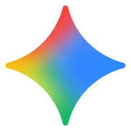
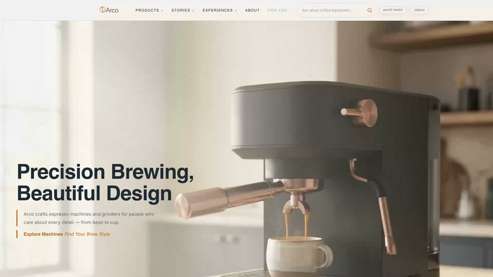
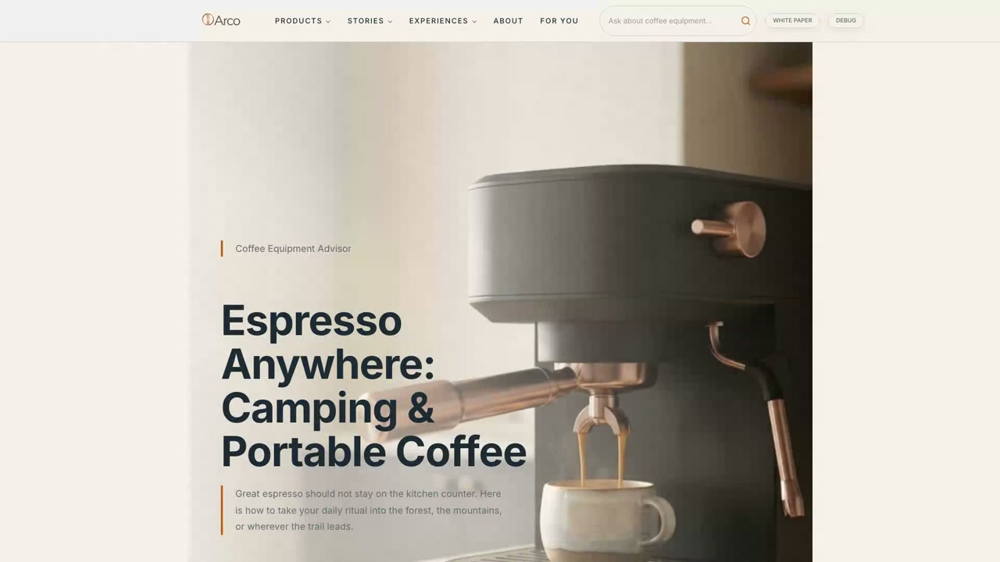
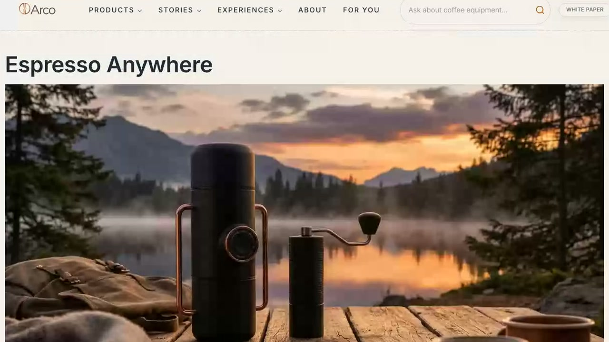
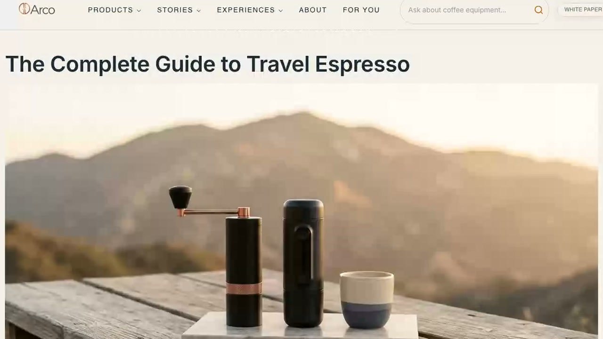
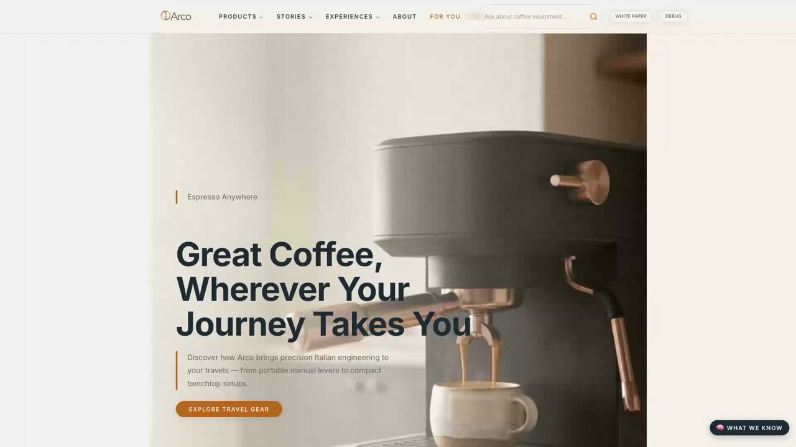

<!-- .slide: class="hook" data-autoslide="8000" -->

Gemini

  

    
One brand. A different experience.

    <h1>Why show every visitor the <em>same</em> website?</h1>
    
Let their intent shape the page.

  

  

    <figure class="site-card original-card">
      <figcaption>One homepage</figcaption>
      
    </figure>
    <figure class="site-card generated-card">
      <figcaption>A page for your next adventure AI generated</figcaption>
      
    </figure>
  

Note:
Attract loop: five independently understandable slides, 60 seconds total (8 / 14 / 12 / 12 / 14). All displayed media is local; no generation request is made by this deck. Press F for full screen. Pause loop stops automatic advancement; arrow keys still allow manual navigation. Source for all screenshots and the clip: arco/build-demo/recordings/google-20261108-custom-url-verified/arco-google-cloud-demo.mp4, recorded November 8, 2026. Homepage frame: 0.8 seconds; generated frame: 56 seconds. Arco is a fictional coffee brand demonstrating real site mechanics. Gemini mark: Google's official asset at https://www.gstatic.com/lamda/images/gemini_sparkle_aurora_33f86dc0c0257da337c63.svg, stored locally for offline playback.

---

<!-- .slide: class="query" data-autoslide="14000" -->

Gemini

  

    
A question becomes an experience

    <h2>Ask a question. <em>Get a page.</em></h2>
    
&ldquo;Coffee for camping?&rdquo;

    
Products. Comparisons. A page built around your goal.

  

  <figure class="demo-window">
    <figcaption>Arco / AI page generation Recorded demo / 1.5x playback</figcaption>
    <video data-autoplay muted playsinline preload="auto" poster="attract-media/query-poster.jpg" width="1280" height="720" aria-label="Recorded Arco demo: a camping coffee query generates and streams a page with product recommendations and a comparison table. Playback is 1.5 times the recorded speed.">
      <source src="attract-media/query-demo.mp4" type="video/mp4">
      Your browser does not support this video. The live demo shows a question becoming a complete page.
    </video>
  </figure>

Note:
The prompt is a short summary of the actual recording's query: "I'm looking for a coffee machine to use when camping in the middle of the forest". Clip: 46.439-65.912 seconds of the November 8 verified recording, condensed to about 13 seconds at 1.5x playback, with no audio. The visible playback label is intentional: this is not a real-time generation-speed benchmark. Query generation runs afresh; do not claim a deterministic query-result cache or instant generation. The video restarts when Reveal revisits this slide and holds its last frame until the next slide.

---

<!-- .slide: class="journey" data-autoslide="12000" -->

Gemini

  
No perfect prompt required

  <h2>Your browsing becomes <em>the brief.</em></h2>
  

    <figure class="journey-card">
      
      <figcaption>01<strong>Explore a product</strong>Espresso, anywhere.</figcaption>
    </figure>
    &rarr;
    <figure class="journey-card">
      
      <figcaption>02<strong>Follow your interests</strong>A guide for the journey.</figcaption>
    </figure>
    &rarr;
    <figure class="journey-card for-you-card">
      
      <figcaption>03<strong>Discover &ldquo;For You&rdquo;</strong>A page shaped by that context.</figcaption>
    </figure>
  

Note:
Screenshots are real frames from 13, 24, and 36 seconds of the verified November 8 recording. The first two are cropped to the authored content region for legibility. Browsing signals build session context; selecting For You generates a personalized page. This is not a claim that the system trains a model on each visitor or that every query is prefetched and instant.

---

<!-- .slide: class="architecture" data-autoslide="12000" -->

Gemini

  
Under the hood

  <h2>Real content. AI assembly. <em>Edge delivery.</em></h2>
  

    

      01 / Understand
      <h3>Your intent</h3>
      
Question + browsing context

      Browser
    

    &rarr;
    

      02 / Ground
      <h3>Real content</h3>
      
Catalog + guides + retrieval

      Cloud Run + Firestore
    

    &rarr;
    

      03 / Assemble
      <h3>A tailored page</h3>
      
Streamed, reusable AEM blocks

      Vertex Gemini + AEM frontend
    

  

  

    
    Optional
    <strong>Save + publish</strong>
    Document Authoring &rarr; AEM Edge Delivery
  

Note:
The current fork defaults to Google Cloud, not the retained Cloudflare alternative. Cloud Run hosts the generation service, Firestore supports content storage and native vector retrieval, and Vertex Gemini generates the page content. The browser renders streamed blocks in the AEM frontend. Saving and publishing through Document Authoring is a separate optional action, not a prerequisite for each generated query page. The loop performs neither inference nor publishing. Architecture references: arco/README.md and arco/services/recommender/README.md. No performance numbers, infrastructure-scale promises, or stale block/content counts are implied.

---

<!-- .slide: class="google-cloud" data-autoslide="14000" data-background-color="#1c2b35" -->

Gemini

  
Serverless demo architecture

  <h2>Built on <em>Google Cloud.</em></h2>
  

    

      Experience
      <h3>AEM Edge Delivery</h3>
      
Browser + streamed blocks

    

    

      HTTPS
      &rarr;
      &larr;
      NDJSON
    

    

      
Google Cloud / Managed services

      

        

          <h3>Cloud Run</h3>
          
Generation API Streaming orchestration

          Scales to zero
        

        &harr;
        

          

            <h3>Vertex AI</h3>
            
Gemini + embeddings

          

          

            <h3>Firestore</h3>
            
Content + vectors Sessions + feedback

          

        

      

      

        
<strong>Cloud Tasks + Scheduler</strong>Async evaluations + recovery

        
<strong>Cloud Storage</strong>Oversized run payloads

        
<strong>Secret Manager</strong>Adobe + admin credentials

      

    

  

Note:
The AEM Edge Delivery frontend is outside the Google Cloud service boundary. The browser calls the Cloud Run generation API over HTTPS and renders its NDJSON stream. Cloud Run coordinates Vertex Gemini generation and embeddings with Firestore Native documents and vector retrieval. Firestore also stores sessions, feedback, evaluations and configuration. Cloud Tasks runs background evaluations; an authenticated Cloud Scheduler job provides recovery. Private Cloud Storage holds payloads that exceed Firestore document limits, not the primary published website. Secret Manager holds Adobe and admin credentials; Vertex uses service-account authentication. This low-traffic demo configures Cloud Run for zero minimum and one maximum instance. "Scales to zero" describes that runtime setting, not a zero-cost promise for storage, scheduling, builds or inference. Optional publishing through Document Authoring and AEM Edge Delivery is shown on the preceding slide. Source: arco/services/recommender/README.md. The main presentation remains at index.html; this separate attract.html loop performs no inference or publishing.
