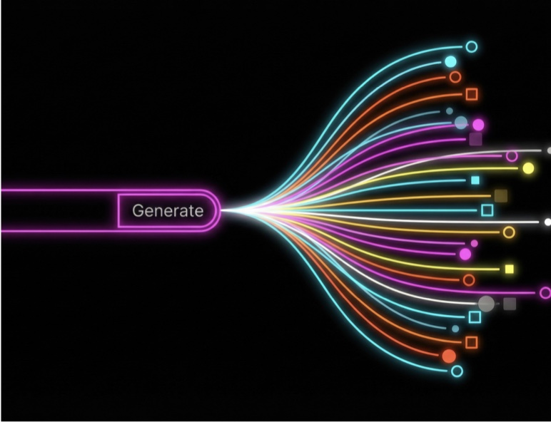
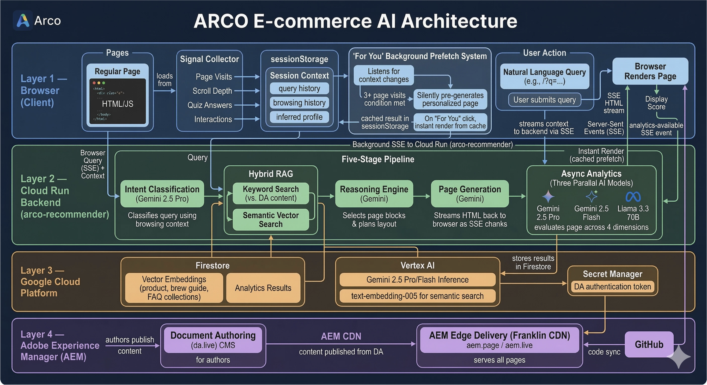
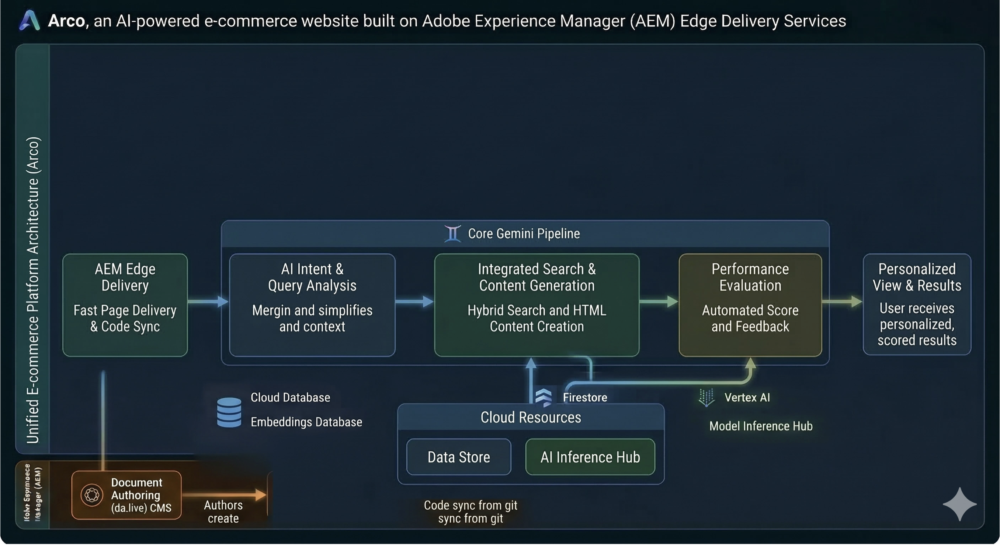
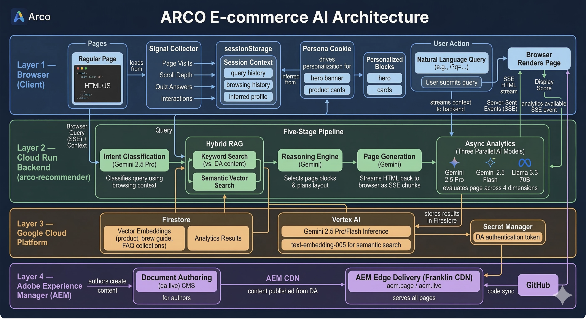

<!-- .slide: class="title-slide" data-background-color="#eb1000" -->

# Agentic Sites: Building Hyper Personalized Websites

---

## Agentic Sites: What and How

### Intent-driven site adapts to each user's goals

* Pages personalize in real time based on user persona and queries

### AEM Edge Delivery + AI power the experience

* Combines Edge Delivery Services with Gemini and open-source AI models

### Personalization engine leverages rich content and custom blocks

* Uses **28 custom blocks** and a **257-page content corpus** for deep personalization

---

<!-- .slide: class="split-slide" -->

## Solving Static Site Limitations

### One-size-fits-all limits engagement

Static sites deliver identical content to every visitor, ignoring unique needs.

### Manual authoring can't scale

Creating pages for every possible persona or question is impractical for authors.

### Three-layer personalization unlocks relevance

Persona quiz, query generation, and proactive recommendations adapt content in real time.

---

## Personalization Paths Explained

### Instant Persona Adaptation

Site content shifts in real time based on quiz responses.

### On-Demand Query Generation

Any natural-language question creates a tailored new page.

### Proactive "For You" Recommendations

Browsing signals trigger personalized pages for each user.

---

## Architecture Overview

### Dynamic Frontend with Custom Blocks

AEM Edge Delivery Services enables flexible layouts and real-time updates.

### Real-Time Personalization Engine

Cookies and quiz logic adapt content instantly to user personas.

### AI-Powered Backend Integration

Using models for deep personalization.

### Rich Content Corpus & Analytics

257-page content corpus and analytics drive tailored experiences and tracking.

---

<!-- .slide: class="split-slide" -->

## Persona Quiz: Six Unique Profiles

### Six Distinct Personas Identified

Quiz maps users to Morning Minimalist, Upgrader, Craft Barista, Traveller, Non-Barista, or Office Manager.

### Homepage and Recommendations Adapt Instantly

Hero, product cards, blog feed, and navigation change based on persona.

### Personalized CTAs and Navigation

Call-to-action and navigation links are tailored for each persona.

### Active Persona Banner for User Awareness

A slim banner signals which persona is currently active.

---

<!-- .slide: class="split-slide" -->

## "For You" Proactive Generation

### Passive Browsing Signals

Tracks page visits, scrolls, quiz answers, and product interactions

### Profile-Driven Query Synthesis

Transforms user activity into a personalized natural-language query

### "For You" Instant Access

Prefetched page appears as a navigation link for immediate viewing

### Continuous Context Refresh

Re-triggers when user context changes, ensuring up-to-date personalization

---

<!-- .slide: class="split-slide" -->

## Query Generation: Intent Mapping

### AI-Powered Page Creation

* URL parameters like `?q=...` trigger dynamic, personalized pages.

### Intent Classification Engine

* Queries are mapped to 13 distinct intent types and journey stages.

### Adaptive Block Selection

* AI chooses relevant blocks and follow-up suggestions based on user needs.

---

## Block Palette: Dynamic Composition

### Intent-Driven Block Selection

* AI chooses from **21 block types** to match user intent.

### Flexible Layouts, No Templates

* 28 frontend blocks enable dynamic, personalized page assembly.

### Personalized Block Order

* Block sequence adapts to each user's goals and journey stage.

### Rich Content Variety

* Includes products, guides, interactive tools, media, and utilities.

---

## Content Corpus: Rich Grounding

### Extensive Content Library

* Over 257 JSON files span products, guides, experiences, blog, tools, and bundles.

### Persona-Adapted Product Pages

* Product pages are tailored for different user personas, ensuring relevant recommendations.

### Head-to-Head Comparisons

* Direct product comparisons help users make informed decisions.

### Draft HTML Pages for Expansion

* Ready-to-author draft pages enable rapid site growth and deeper coverage.

---

## Streaming Experience: Real-Time Build

### Interactive Page Assembly

Recommendations and content blocks appear in real time as the page builds.

### Streaming Events Sequence

Reasoning, block content, and images stream to the browser step-by-step.

### No Waiting Cliff

Users see the site adapt instantly&mdash;no single loading screen.

---

## Auto-Persist: From AI to Published

### Instant AI-to-Site Publishing

Pages auto-save to Document Authoring and publish to AEM.

### Immediate Access with Live URLs

Preview and live links are returned for direct viewing.

### Editable and Versioned Content

Generated pages become fully editable, versioned, and cacheable.

---

<!-- .slide: class="takeaways" -->

## Key Takeaways for Authors & Devs

### Multiple Personalization Paths

Quiz, query, and proactive prefetch adapt content to user intent.

### Intent-Driven Block Assembly

AI selects blocks based on user goals and journey stage.

### Deep Personalization via Context

Browsing signals and persona quiz drive tailored experiences.

### Seamless Authoring & Publishing

Streaming generation and auto-persist enable fast, editable pages.

### Rich Content & Flexible Models

257-file corpus and 16 model presets support diverse use cases.

---

<!-- .slide: class="confidential" -->

## ARCO Demo Walkthrough

### Setup

* A made-up coffee brand to demo real mechanics

### Persona quiz demo

* Answer 4 questions; show hero, nav, and cards change

### Query generation demo

* Run a query and watch the personalized content stream

### "For You" prefetch demo

* Browse 2+ pages; wait for nav link to appear
* Click it: pre-generated page renders instantly from cache

---

<!-- .slide: class="diagram-slide" -->

---

<!-- .slide: class="diagram-slide" -->

---

<!-- .slide: class="diagram-slide" -->

